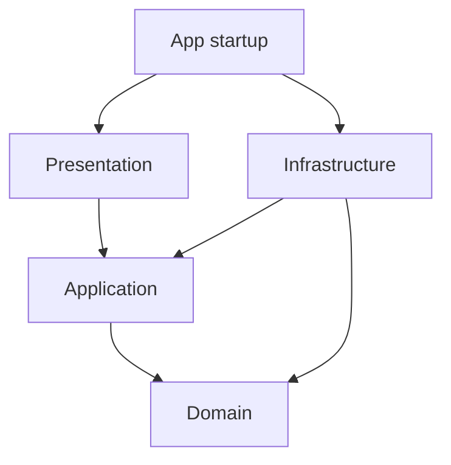

# Architecture and migration

## Boundaries

One frontend package, strict TypeScript for the typed layers, checked JavaScript
for the migrated editor, Vite, and explicit dependency injection.
`npm run check:boundaries` checks JavaScript and TypeScript imports, including
re-exports, type imports, dynamic imports, and require calls. Domain and application
code cannot import external packages; presentation cannot import infrastructure.

## Migrated editor

`src/app/editor.ts` composes IndexedDB, the project service, and the mounted editor.
The original standalone HTML has been removed; neither production nor tests load it.
`editor.html` is the Vite entry. The presentation HTML fragment and CSS preserve the
supplied controls and appearance. Three.js is pinned to 0.128.0 and bundled locally.

| Layer | Modules and ownership |
| --- | --- |
| Domain | Registries in `wardrobe/`: `fittings.ts` (fitting kinds and their traits), `possessions.ts` (what Auto design plans for), `purposes.ts`, `zone-style.ts`; `catalog.js` derives the older tables from them. `wardrobe-planner.js` (numerical engine) and the `selection-*` space search. `wardrobe-geometry.js` composes `geometry/wardrobe-rules/` (sizes, ceiling, layout, fit, dividers, boxes, spaces, movement, measurements, costing, planner-config). `cabinet-geometry.js`, `shape/` (see [wardrobe shapes](wardrobe-shapes.md)). Plain centimetre data; no DOM, Three.js or markup. |
| Application | Strict TypeScript command families, `scene-commands.ts`, `editor-model.ts`, `scene-history.ts`, `planner-service.ts`. Fittings, shelves, dividers, duplication, sizing, finishes, doors, profiles, cabinet edits, snapshots and history. |
| Infrastructure | Existing project repositories and strict serialization, with validated layout intent for lossless reopening. |
| Presentation | Camera, frame rendering, dimensions, movement overlays, viewport handles, scene picking, divider/cabinet dragging, item resizing, scene selection, inspector panels, measurements, item actions, the Add item menu (`add-menu-presenter.js`), planner, shell, and event bindings grouped by feature in `editor/bindings/`. |
| Composition | `editor-runtime.ts` constructs the model, commands, resources, states and controllers, connects their ports, and mounts event bindings. It contains startup wiring, with no copied geometry or gesture implementations. |

Application commands receive callbacks for checkpoints and presentation effects.
They import no DOM or Three.js APIs. Presenters query domain rules and route design
mutations through commands. Presentation state is created per editor: camera, rendering, interactions, selection,
planner and shell have separate stores. Frame timestamps belong to the renderer
instance. Rendering another cabinet uses a local design reference and cannot change
the application model’s active cabinet.

`three-viewport.ts` implements the existing `Viewport` contract. Rendering accepts
`ProjectDocument` and `EditorSession`; the view adapter resolves canonical selection
IDs into transient editing context. Resize requests reach the renderer. Disposal
cancels frames/timers, detaches listeners, disconnects observers, and frees geometries,
materials, textures and the WebGL renderer. Browser startup also cleans up project
controls and the database connection on unmount/hot reload.

## Registries and enforced rules

Fitting kinds, possessions and purposes are each defined once, in a registry under
`src/domain/wardrobe/`. Everything that depends on them (planner categories and
limits, saved-project enums, Add item menu, zone styles, icons, wizard fields) is
derived. Rules that apply to several kinds ask for a trait (`hasTrait(kind, 'pullout')`)
instead of listing kinds. `tests/architecture/fittings.test.ts` and
`possessions.test.ts` walk every registry entry through every derived place.

`scripts/check-architecture.mjs` (part of `npm run check`) fails on files over 400
lines, lines over 240 characters, hand-written kind or possession lists, and HTML in
the domain. Older code is held by a ratchet in `scripts/architecture-baseline.json`:
a listed file may only improve.

## Module contracts and lifecycle

Factories receive named dependency groups. Their adjacent `.ports.d.ts` contracts
expose only the service methods and state fields each factory uses, using
`Readonly<Pick<...>>` for collaborator APIs. Smaller feature modules accept explicit
callbacks for the parent behavior they need. There is no unrestricted `editorPorts`
registry or duplicated getter/setter facade.

Some camera, rendering, inspector and interaction operations collaborate in both
directions. The composition root uses typed `ModulePort<T>` connections for these
relationships: it constructs all ports, connects each once, then installs events.
Access before connection and API replacement throw. Connected implementations are
frozen; responsive behavior uses an explicit `syncResponsive()` method rather than
replacing the inspector's `ui` function.

`mount-editor-bindings.js` distributes dependencies to focused binding modules.
The root owns the editor lifetime and viewport resources. Startup failure and normal
disposal both clean up the lifetime. Event listeners, scheduled frames, observers,
timers and Three.js assets must register with those owners.

`mount-editor.ts` is the public composition boundary. Each mount owns an open
ShadowRoot, a DOM scope, controls, keyboard ownership, state, canvas and lifecycle.
Original control names remain available through `data-editor-id`; actual IDs are
unique per mount, including dynamically created controls and label associations.
Queries and listeners use the injected DOM scope. Keyboard shortcuts reach the
active editor; pointer gestures can finish outside its canvas. Disposing one editor
removes its listeners, observers and rendering resources without affecting another.

Responsive layout uses the mount container's dimensions and container queries.
The embedding container must have a definite height. Styles remain isolated in the
ShadowRoot; the preserved markup and CSS baselines are transformed at mount time.
The two-editor example exercises independent state and disposal/remounting. See
[extending the editor](extending-editor.md) for the mounting API and change examples.

`design-commands.ts` composes appearance, divider, sizing, layout and item command
families. A shared typed workflow owns checkpoint and change notification ordering;
individual families receive only the geometry and effects they need. Cabinet rendering
composes layout assembly, typed frame geometry, doors, fittings and materials.
The typed disposal module frees each owned geometry/material once, handles material
arrays and allocated unused materials, and preserves shared assets until viewport
teardown.

## Design and UI state

`ProjectDocument` and the domain `EditorDesign` store serializable design data.
The application `EditorState` adds selection, the selected free space and open-door
state for the working scene; these fields do not belong to the domain design. The mapper
in `application/projects/editor-mapper.ts` produces canonical dimensions,
positions, section widths, item geometry, and dividers. It maps the editor's
“hinged” door name to the existing model's “solid” door value and reverses that
mapping when opening.

Optional, strictly validated `editorItem`, `editorDivider`, and `editorLayout`
fields preserve details that resolved geometry alone cannot express: full-width
versus fixed-width items, alignment versus pinned coordinates, implicit stacking,
per-item finishes, divider travel regions, section weights, planner engagement,
standard reach, and proposal text. Metadata is checked against the canonical
geometry to prevent it from silently overriding a validated design. Old v1
projects without these optional fields still load; their canonical coordinates
become explicit item placements. Unknown versions are rejected.

Snapshot hooks assign stable item/divider IDs before history or saving. Duplicates
receive fresh IDs; moves retain IDs. Selection, open doors, camera state, meshes,
render resources, active cabinet, and ID allocation counters are transient and
are not persisted. Reopening selects the first cabinet and starts fresh UI history.
The dirty comparison also excludes transient state.

## Saving and concurrency

The existing repository contract and IndexedDB schema are unchanged. A new
project uses `expectedRevision: null`. Updates use the latest successfully saved
revision. IndexedDB performs revision checking and writing in one transaction;
errors or conflicts do not overwrite saved data or replace the open design.

`editor-project-session.ts` owns the storage revision independently of scene
undo/redo history. Undo followed by save uses the latest revision, and a failed
save can be retried. Controls capture an immutable scene at save time. Edits made
while saving stay unsaved and are reported after completion. The standalone
editor creates a project on first save; existing workspace projects open through
`editor.html?project=<id>`.

Saving is explicit through the editor menu. Autosave, cloud synchronization,
authentication, backend persistence, and import/export UI are not implemented.
Browser-local storage can be cleared by the browser or user.

## Regression strategy

Tests import the actual production factories and commands. Historical camera,
selection, divider, measurement and resize scenarios use small dependency fixtures;
they no longer reconstruct functions from source text. Additional tests cover
independent state and frame clocks, immutable controller connections, responsive
bindings with a frozen inspector API, and compile-time dependency restrictions.
Immutable SHA-256 baselines guard the original planner, controls and styles without
retaining the standalone HTML. A retirement guard asserts that the file is absent.

Architecture checks enforce import direction across JavaScript and TypeScript and
guard presentation against direct writes to design fields. `typecheck:editor` runs
TypeScript's JavaScript checker across the remaining geometry, catalog and
presentation modules without filtering diagnostics. JavaScript checking is currently
non-strict; this is not a full strict-TypeScript conversion. The preserved numerical
planner implementation is behind its complete typed public interface and executable
regression tests. Strict TypeScript now covers all application workflows, model,
history and planner cache, plus mounting, DOM scoping, editor composition, camera
state, extracted frame/door/fitting/material renderers and resource disposal. Typed
domain contracts, mapping, persistence, viewport controls and startup remain strict.
Cabinet/layout coordinators, other presenters and domain geometry remain checked
JavaScript. Future modules should use strict TypeScript; converting the preserved
planner requires separate numerical characterization rather than only a file rename.

Browser checks cover the production editor, automatic wizard proposals, applying
layouts, cabinet creation/removal, dimension editing, undo/redo, saving, project
workspace integration, reopening and the mobile settings sheet. These checks provide
regression evidence; they do not claim exhaustive browser testing of every gesture.

## Whole-cabinet planning

Generation routes through the compatibility facade `wardrobe-composer.ts` into the
strict TypeScript space-selection planner before application caching. Separate
modules own archetype gates/concepts, hero metrics, DNA/family selection, clear
rectangles, fitting candidates, per-archetype beams, finalization and shared scoring. Search uses millimetres internally and
converts results to the existing centimetre project model. The numerical planner
remains the capacity/geometry oracle. Manual ratings and bay autofill share the new
scoring/search path. Existing explicitly positioned manual fittings and dividers are
preserved. Inputs, fitting kinds and persistence remain compatible. See
[Auto design algorithm and limits](smart-auto-design.md).
