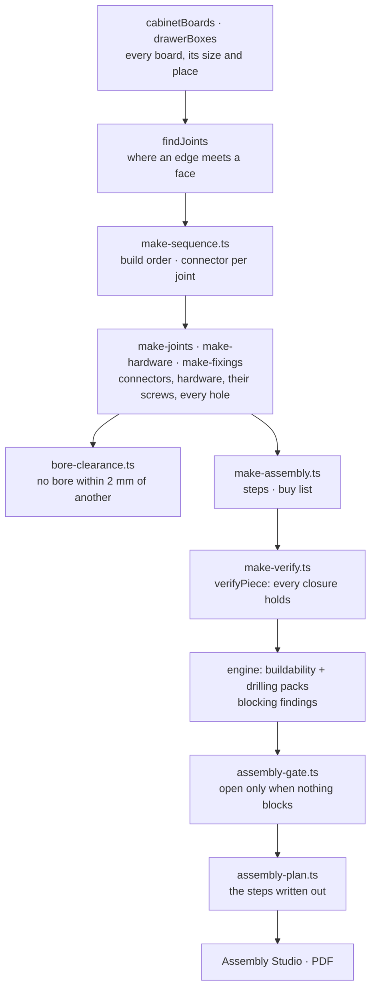

# Buildability: from a design to something that can be put together

A design leaves the editor as boards to cut, holes to drill, hardware to buy and steps to follow. If any of those is
wrong, someone orders the wrong thing or stands at a bench with a part that does not fit. So the app does not assume
its output is right: it **proves it on every piece, every time**, and a piece that fails does not reach assembly.

Nothing here is written for a wardrobe or for a kitchen unit. Each layer reads the one before it, so a product nobody
has built yet goes through the same pipeline:

## What a person sees

- **Assembly opens only for a piece that can be built.** The Assembly tool, a part's stage link, a hardware row, the
  browser's Forward, and saving the drawings or cut list all ask one gate. While anything blocks the piece, the panel
  shows *Not ready to assemble*: each thing to fix with the rule it breaks, *Show* on a row that has a part, **Design
  check** (where findings have their fixes) and **Check again**.
- **Assembly Studio's guidance writes the step out**: each numbered part in the order it goes in, where it ends up and
  what it stands on or against; each joint and each piece of hardware with how many, what size, which parts, and how
  far each is from an edge to put a tape on; the screws that hold it; what to measure before going on, with the number.
  Under the chapters, **Before you start**: how to build it, how many people, how long, the tools.
- **The saved drawings print the whole plan** after the hardware page.
- **Design check** lists buildability findings with the rest; they block, like the manufacturing check's.

## The layers (domain, centimetres; holes and reports in millimetres)

### Build order and connectors: `make/make-sequence.ts`

One rule on every joint: **the board on the left, underneath or behind goes in first.** A carcass then goes together
from the left side, bay by bay from the bottom up, to the right side; then the top; then the back (before the top when
it slides into grooves). In that order every board still has a free way in: nothing has to go between two boards that
are both fixed.

Each joint is decided when the later of its two boards goes in:

- a **screw** (the piece's own, or instead of a cam or dowel) needs its head reachable: no board already in place
  within a driver's length (150 mm, 15 mm either side) behind any of its stations. A screw up through a board near the
  floor is a last resort, and none is used: a piece can always be built standing;
- a **dowel or cam** (the piece's own, or instead of a screw) needs the board free to travel 35 mm onto it, and all
  the joints it closes at once to close the same way.

`JointChoice.instead` says why a joint has another connector than the piece's: `covered` (the screw heads would be
behind a board already in, as with the second of two shelves level either side of a partition), `underneath`,
`captured` (no way onto cams between fixed boards). `stuck` marks a joint that can be made neither way.

### Drilling in three dimensions: `make/bore-clearance.ts`

Every hole is the cylinder a drill leaves. Two clash when less than 2 mm of board is left between them, whichever
faces or edges they are drilled from: side by side, crossing at a right angle inside the board, or end to end from
opposite faces (1 mm between their ends). The same rule sets connectors, plates, runner screws and pin rows out (they
step along System 32 until clear) and checks the result, so nothing set out clear is ever reported.

### The screws that hold hardware: `make/make-fixings.ts`

Every hardware entry names its `fixings` in the registry. They are counted from there for every fitting (two through
each hinge cup's ears, two Euro screws a plate, a machine screw as long as the front is thick plus 5 mm of thread
behind each handle hole) and fitted in the step that fits the hardware. `fixingMisfit` holds a screw to the board it
goes into: its length less a 1.5 mm flange stays 1 mm inside the far face.

### The proof: `make/make-verify.ts`

`verifyPiece(makePiece)` returns every defect, or nothing:

| Kind | What must hold |
|---|---|
| `cut-size` | each board's cutting size is exactly the size it occupies |
| `count` | each board in one part and one step; each fitting in one step; buy list = steps = fittings; each hole drilled for something fitted |
| `unheld`, `loose` | each board held, at two points or more (a back by nails or three grooves, a loose shelf by four pins, a door by two hinges on an upright) |
| `mechanism` | a front that pulls out has runners or a frame set out for it |
| `connector` | a screw and its pilot share a centre line; it reaches 20 mm (15 for a 4 mm screw) into the board behind and no deeper than its pilot; a dowel's holes hold its length; a cam sits where its bolt arrives; a hole in an edge keeps 2 mm of board either side |
| `fastener` | a fixing screw stays inside its board; a bolt through a front keeps 5 mm of thread |
| `bore` | no clash, no meeting, no breakout, nothing drilled past the board |
| `joint` | no joint is stuck |
| `order` | what joins two boards goes in when both are there |

### The gate: `engine/assembly-gate.ts`, `engine/rules/buildability-pack.ts`

The buildability pack turns each defect into a blocking finding; the drilling pack blocks on drilling that cannot be
made (a hole inside the board but near its edge stays advice). `assemblyGate(evaluation, piece)` is open when no
blocking finding names the piece, from any pack. A piece too tall to be stood up in its room is told so as advice
(`make/stand-up.ts`: it needs its diagonal across height and depth, plus 10 mm).

### The plan: `make/assembly-plan.ts`

`assemblyPlan(makePiece, { ceiling? })`: method (bench under 1200 mm; lying and stood up where the ceiling allows the
diagonal; standing where it does not), people, minutes, tools, and for each step its parts, places, fixes and checks.
Wording comes from the hardware registry (`assembly.instructions`, the stage titles); every number comes from the
piece. `presentation/make/assembly-plan-text.ts` words it for Assembly Studio and for paper.

## Extending it

- **A new product kind**: return its boards (as `cabinetBoards` does). Joints, order, connectors, drilling, steps,
  verification, gate and plan follow. Run `tests/architecture/buildability.test.ts` with it in `construction-cases.ts`.
- **A new check**: one function in `make-verify.ts` reporting `BuildDefect`s, added to `verifyPiece`'s list.
- **New hardware**: its registry entry's `fixings` (with lengths that pass `fixingMisfit` for its thinnest board),
  `assembly.instructions`, and `assembly.minutes` where it is quicker or slower than its category.
- **A set mounted whole** (a mechanism bought as one thing): name it in the fitting's `hardware`; it becomes a fitting
  on the boards it mounts on when the registry sells it as a `set`.

## Decisions (keep them)

- **Prove, do not assume.** The verifier runs in the engine on the design in front of the person, not only in tests.
- **What cannot be built blocks.** Loads are estimates and warn; closures either hold or do not.
- **One clearance rule** for setting out and for checking.
- **The plan is derived.** No sentence in it is written for a product; a number in it is where the hole is.
- **A joint says why** when it is not made with the piece's own connector.

## Known limits

- **A pantry pull-out is set out as a cargo pull-out at larder height** (frame, baskets, runners, front brackets): the
  registry has no wider larder frame of its own yet.
- **The film is still a standing build.** It brings the boards in in the planned order, but it does not show the carcass
  lying down or being stood up; the plan's *Before you start* says how.
- **Sets mounted whole** (pull-down rail, trouser rack, basket, flap lift, corner mechanism, appliance kit, shelf
  brackets) and the screws that hold hardware are counted and stepped, not drawn in 3D or set out hole by hole: they go
  on by their maker's template.
- **Tool access is a box**, 150 mm behind each screw head: it does not know an angle driver, or a wall the piece is
  already standing against.
- **A filler strip and an end panel** are screwed from the cabinet beside them; those screws are counted with the strip,
  and their holes in the neighbour are not set out.
- **Fixed shelves in a cam or dowel piece** are screwed at the end an upright closes onto them last (said in the plan).
- **Times** are estimates per fitting and per board for someone who has done it before; drilling is not included.

Tests: `tests/architecture/buildability.test.ts` (the proof over every unit, preset, shape, the golden and welcome
designs and Auto design from 60 to 300 cm, in all joint systems; the drilling rule; fasteners; the gate; standing up),
`tests/architecture/assembly-plan.test.ts` (the plan closes on its piece; its set-out is where the holes are).
