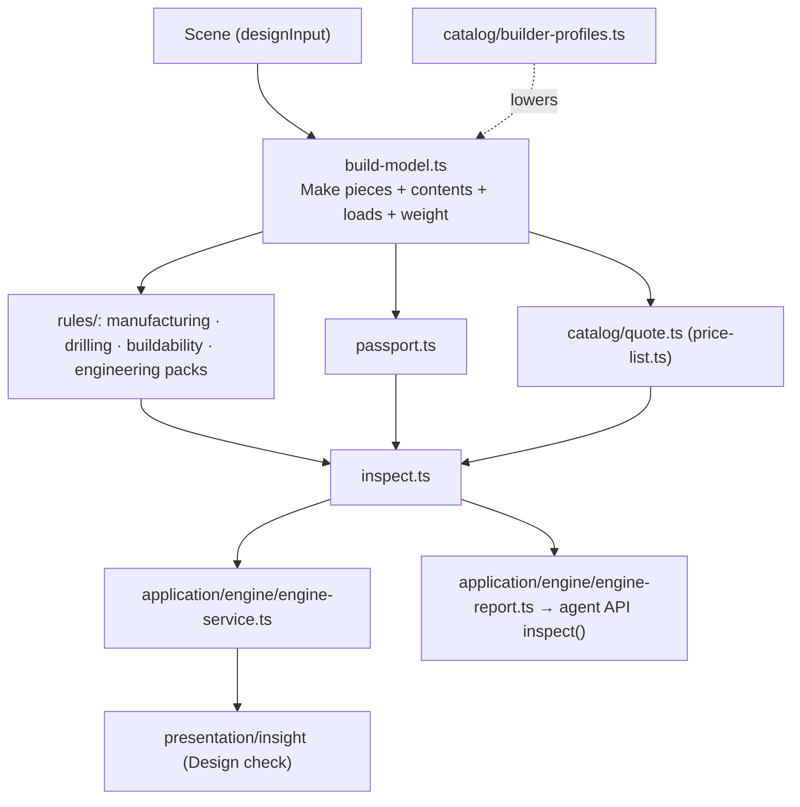

# The engine: build model, rules, physics, prices

`src/domain/engine/` is the layer every feature can read to know what a design **is** when built: its parts, what it
carries, whether it can be made, and what it costs. It does not derive the furniture again: it builds on Make, which builds
from the same board list as the cutting list and the drawings. So the engine, Make, the drawings and the manufacturing check
agree by construction (and `tests/architecture/engine.test.ts` proves the boards are the same).

## What a person sees

**Design check** in the editor menu (its badge counts what blocks building) opens a panel, a bottom sheet on phones:

- **Check**: every finding, most serious first, identical ones grouped (manufacturing, drilling, buildability, loads). Each says what, why, how far over its limit, and
  offers its fixes. *Split the bay* puts a partition under the middle of a bay and keeps its layout on both sides (one undo step).
- **Price**: the design *built yourself*, *cut and drilled*, or *built and fitted*, in zł, € or $, with the lines behind each.
- **Passport**: parts, boards, sheets and yield, edge banding, holes, hardware, empty weight, planned contents, assembly time.
- **Changes**: what changed since the panel opened, in a carpenter's words.

The engine runs only while someone looks: when the menu opens (for the badge, just after it opens) and, while the panel is
open, once the design has stayed the same for 600 ms. A drag is never interrupted. Selecting or opening doors is not a change.

Agents get the same through `window.furnidraw.inspect(spec?, currency?)` and the WebMCP tool `inspect_design`.

## Files

| File | What it owns |
|---|---|
| `domain/engine/build-model.ts` | `buildModel(input, { construction? })`: every piece from Make, its contents, loads and weight; a revision |
| `domain/engine/physics/substrate.ts` | What a board is made of under its decor (density, stiffness, creep), from the decor's construction |
| `domain/engine/physics/contents.ts` | What each fitting holds (its purpose's `load` in the registry) and what carries it: boards, a rail, runners |
| `domain/engine/physics/structure.ts` | Load checks: shelf sag, rail span, lift and runner load, hinge load, as a share of the limit |
| `domain/engine/rules/` | `EngineFinding`, `Fix`, rule packs and `RULE_PACKS` |
| `domain/engine/rules/buildability-pack.ts`, `domain/engine/assembly-gate.ts` | Make's proof that each piece can be built, as blocking findings; the gate into assembly ([buildability.md](buildability.md)) |
| `domain/engine/passport.ts` | The numbers a workshop quotes by |
| `domain/engine/catalog/` | `price-list.ts` (dated prices), `builder-profiles.ts`, `quote.ts` |
| `domain/engine/scene-diff.ts` | What changed between two versions |
| `domain/engine/inspect.ts` | One call: model, passport, evaluation, quotes |
| `application/engine/` | `engine-service.ts` (re-inspects on design changes, change history, product events), `engine-fixes.ts`, `engine-report.ts`, `scene-input.ts` |
| `application/commands/bay-split-commands.ts` | Split a bay keeping its layout (the fix behind *Split the bay*) |
| `application/ports/product-events.ts` | Where product events go (nowhere by default) |
| `presentation/insight/` | The Design check panel |

## Extending it

- **A rule pack** (a country's standard, a hardware maker's rules, a workshop's limits): one module in `domain/engine/rules/`
  returning `EngineFinding`s from the build model, and one line in `RULE_PACKS`. Findings are data; give a fix only when an
  editor command can apply it (`FixAction`, then `application/engine/engine-fixes.ts`).
- **A builder profile**: one entry in `BUILDER_PROFILES` (a construction Make builds, services, labour).
- **Prices**: `price-list.ts`, dated by `PRICES_AS_OF`; hardware prices are each entry's `costEur` in the hardware registry.
- **How heavy something stored is**: the `load` on its possession or purpose entry (`storage-load.ts`). The registry test
  fails without one.
- **A hardware rating**: `ratedLoadKg` (runners, lifts), `loadKg` on hinge variants, `maxSpanMm` (rails, shelf pins).
- **A new consumer** (an export, a CNC format, an AR model): read `buildModel`, never the 3D renderer.

## Decisions (keep them)

- **One source of truth.** The model wraps Make; it never re-derives boards. A new output reads the model.
- **What cannot be built blocks.** A buildability defect or drilling that cannot be made is a closure that does not
  hold, not an estimate: it blocks, and closes the gate into assembly.
- **Loads are estimates and never block.** Engineering findings warn (over the limit) or advise (over 85%). The blocking
  rule on spans stays D2 in the manufacturing check.
- **Shelf sag**: a beam on two supports (conservative: fixed shelves are partly restrained by their joints), long-term
  creep 1.5 for wood-based boards, limit span/200. With these, an 80 cm 18 mm chipboard shelf of folded clothes is at about
  65% of its limit and a 120 cm one is over, consistent with D2's 800 mm span for 18 mm.
- **Prices**: boards charged by the sheets the cut layout uses (a sheet over half used is bought whole; a part sheet by its
  parts' area plus 25%). Before VAT, in the visitor's currency at the credits' rates.
- **Fixes use the editor's commands**: a fix is what a person could do by hand, with the same checks and one undo step.

## Known limits

- The planner does not read the engine yet: Auto design can propose a shelf the engineering pack warns about (it never
  proposes one the manufacturing check blocks).
- Loads: one load density per purpose; no point loads, no racking of the carcass, no tip-over check, no wall-fixing
  calculation. Hinge ratings use the hinge variant Make chose, or the default.
- Prices are one indicative list (Poland and the EU, late 2026). There is no supplier or workshop price list yet, and
  no delivery or installation travel.
- The change history lives in the open editor only (not saved with the project), and covers changes seen while the panel
  was open or the menu was opened.
- Product events go nowhere: `NO_EVENTS` is wired. An analytics adapter in `infrastructure/` is the next step.
- Kitchens are checked and priced, but corner runs and worktop cut-outs are not modelled (see furniture.md).
