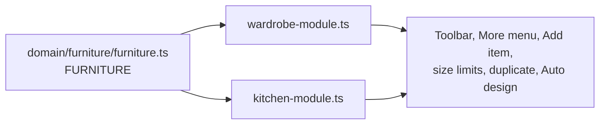

# Furniture: wardrobes and kitchen cabinets

The editor builds more than one kind of furniture. Everything a piece of furniture shares
(the room, moving, resizing, shaping under a ceiling, sections, Add item, undo, the
Storage counter) is one engine; what differs is a **furniture module**.

## The model

- A cabinet in the scene is a wardrobe unless its design says `product: 'kitchen'`, with a
  `unit` (`base`, `upper`, `tall`). Both fields are optional, so every older project and the
  golden fixtures are unchanged, and both are saved (`editor-mapper.ts`, `project-codec.ts`).
- `furnitureModule(design)` returns the module for a design. Shared code asks it instead of
  knowing wardrobes or kitchens:

| The module says | Used by |
|---|---|
| `sizes(design)`: width, height, depth limits | resize commands, placing, size fields and sliders, on-model size pills |
| `allows(kind, design)`, `fittingKinds(design)` | Add item, Replace, the type menu, keyboard shortcuts, the command guard |
| `duplicate(design)` | Duplicate, and pull-to-array |
| `reset(design)` | More › Reset (a kitchen cabinet goes back to an empty unit of its kind) |
| `autoDesign` | Auto design leads the toolbar; the planner refuses others |
| `wholeDoors` | whole-front doors (More › Doors); kitchen fittings show their own fronts |
| `label`, `noun`, `addLabel` | Add sheet tabs, messages, the Add tool's name (New wardrobe / Add cabinet) |
| `shaped` | a Shape tab beside Size |

Toolbars come from the registry too (`domain/wardrobe/contextual-actions.js`). Every kind of furniture
shows the same tools in the same order, the steps furniture planners use, so learning one teaches the other:

| Tool | What it opens |
|---|---|
| **Add** | The Add sheet on this kind: another one beside the selected piece |
| **Interior** | A menu: Auto design (where the module plans), Sections, Add item |
| **Size** | Width, height, depth; a Shape tab where the module is `shaped` |
| **Fronts** | Doors (where the module has `wholeDoors`) and the finish, on one sheet |
| **More** | Duplicate, Reset, Remove |

With nothing selected, Furniture shows only Add, Undo and Redo: Add opens one sheet with a tab per kind
(the Add context `furniture`), and furniture already in the room is selected by tapping it. A new project
starts without furniture.

**Measurements on the model** (W, H, D, an item's or a divider's sizes) are readings in Furniture: a drag
or a tap passes through them to the furniture, so touching a piece always moves it. While a Size sheet is open
(the piece's Size or Shape, an item's or a divider's Size) they are controls: drag to change, tap to type. A
tap on a piece's W, H or D with Size closed opens Size with that field focused (`dimension-scrubbers.ts`,
`furniture.css`). Studio keeps its measurements as controls.

## Kitchen cabinets

| File | What it owns |
|---|---|
| `domain/kitchen/kitchen-units.ts` | Base, wall and tall units: sizes, limits, height above the floor, worktop and plinth |
| `domain/kitchen/kitchen-design.ts` | Presets for the Cabinets panel (plain units start empty), new designs, duplicates without appliances |
| `domain/kitchen/kitchen-runs.ts` | Runs, shared worktop and plinth spans, poses beside a unit or a run |
| `domain/kitchen/kitchen-storage.ts` | What a kitchen holds, for the Storage panel |
| `application/commands/kitchen-commands.ts` | Add a unit beside the kitchen it belongs to, duplicate, pull-to-array |
| `presentation/viewport/kitchen-fitting-renderer.ts` | Drawer and door fronts, appliances |
| `presentation/viewport/kitchen-run-renderer.ts` | Worktop, plinth, sinks with taps, hobs |
| `presentation/editor/kitchen-panel.ts`, `kitchen-art.ts` | The Cabinets add panel and card art |
| `presentation/editor/kitchen-suggestions.ts` | Add item cards inside a kitchen unit |
| `presentation/editor/kitchen-array-gesture.ts` | Pull-to-array grips and long press |
| `presentation/editor/kitchen-plan.ts`, `furniture-framing.ts` | Storage panel for a kitchen; framing a kitchen run |

Kitchen fittings (cutlery and pan drawers, cupboard door, lift-up flap, open shelf, sink, hob,
oven, microwave, fridge, pantry, cargo) are entries in the one fittings registry, each with a `kitchen` field
naming the units it fits and how Add item ranks it. Traits carry the rules: `front` (shows its
own front), `appliance` (a copy gets plain storage instead), `worktop` (sits in the worktop).

Built-in appliances have a unit prepared for each (Cabinets panel, under *Sinks and appliances*): a sink unit,
hob unit, hob and oven, dishwasher, under-counter fridge, microwave and cooker hood wall units, a freestanding
**cooker** and an oven tower. There is one card per kind, never one per size. A cooker is a unit of its own
(`appliance: true`): it stands in the run at worktop height with its hob on top, so no worktop runs over it, and a
copy of it is a cooker. A tall fridge-freezer (190 cm, no cupboard above) and the fridge housing (215 cm, fridge
over a 25 cm cupboard, the usual way a 178 cm fridge-freezer is housed) differ only in the unit's height.
Every one is resized with Size like any other cabinet (a 90 cm sink or hob unit is the same card at 90 cm).

Presets name a unit and its contents, and may give their own width and height (`size`): the lift-up wall
cabinet is 80 × 40 cm and the microwave wall unit 60 × 50 cm, both wall units.

**Runs are not stored.** Units side by side on one back line form a run (`kitchenRuns`); each
run of base units gets one worktop and each run of floor units one plinth (`kitchenSpans`). Moving a
unit away splits the worktop; pushing it back joins it. The run renderer rebuilds only when a
kitchen unit's pose, size or contents change, every frame, so drags and pulls update it live.

**Pull-to-array.** A selected unit shows a grip at each end of its run. Dragging one outward lays
copies along the run (`arrayCount`: a copy appears once the pull passes 40% of a unit's width),
pulling back removes them, and release keeps them as one undo step. A long press on the unit
(`HOLD_MS`) followed by a slide does the same. Copies keep the unit's size, sections and finish;
`plainStorageFor` puts drawers or a door of the same height where an appliance was.

## Adding a kind of furniture

1. Write its module (`FurnitureModule` in `domain/furniture/furniture-module.ts`) beside its
   domain rules, and add it to `FURNITURE` in `furniture.ts`.
2. Give the design a value for `product` (and any field like `unit`), with codec validation and
   mapper round trip; keep it optional so older projects load.
3. Add its fittings to `fittings.ts` with a field that names where they fit (as `kitchen` does),
   and draw them (a renderer beside `kitchen-fitting-renderer.ts`).
4. Add a panel for what can be added (like `kitchen-panel.ts`) and a root button in `editor.html`
   with `data-furniture="<key>"`.
5. Run `npm test`: `tests/architecture/kitchen*.test.ts` show the checks a module needs.

## Size limits

Centimetres, width × height × depth. Kitchen limits are in `kitchen-units.ts` (`sizes`), the wardrobe's in
`wardrobe-module.ts`; a fitting can still need more than a size allows (its own minimum width, depth and height).

| Piece | Width | Height | Depth |
|---|---|---|---|
| Wardrobe | 80–600 | 180–300 (down to 60 once short or shaped) | 15–90 |
| Base cabinet | 30–150 | 70–100 | 30–80 |
| Wall cabinet | 30–150 | 35–130 | 25–70 |
| Tall cabinet | 30–100 | 150–270 | 30–80 |

The 30 cm width floor comes from the engine's 25 cm minimum bay (see Known limits).

## Known limits

- Floor units use the wardrobe engine's 8 cm base: they stand on an 8 cm plinth. A wall unit has none: its bottom
  board is its lower edge (`plinthOf` in `carcass.ts`; everything vertical starts from it), so its height is the whole
  visible height and its fittings fill it less 3.6 cm of boards.
- Sinks and hobs are drawn on the worktop; the worktop is not cut out under them.
- Design specs (`#spec=`, the agent API) build wardrobes only.
- Corner units and worktops that turn a corner are not modelled: each straight run has its own.
