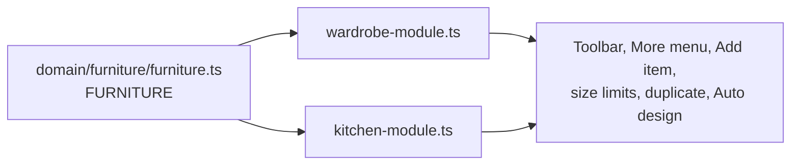

# Furniture: wardrobes and kitchen cabinets

The editor builds more than one kind of furniture. Everything a piece of furniture shares
(the room, moving, resizing, shaping under a ceiling, sections, Add item, undo, the
Storage counter) is one engine; what differs is a **furniture module**.

## The model

- A cabinet in the scene is a wardrobe unless its design says `product: 'kitchen'`, with a
  `unit` (`base`, `upper`, `tall`). Both fields are optional, so every older project and the
  golden fixtures are unchanged, and both are saved (`editor-mapper.ts`, `project-codec.ts`).
- `furnitureModule(design)` returns the module for a design. Shared code asks it instead of
  knowing wardrobes or kitchens:

| The module says | Used by |
|---|---|
| `sizes(design)`: width, height, depth limits | resize commands, placing, size fields and sliders, on-model size pills |
| `allows(kind, design)`, `fittingKinds(design)` | Add item, Replace, the type menu, keyboard shortcuts, the command guard |
| `duplicate(design)` | Duplicate, and pull-to-array |
| `autoDesign` | Auto design leads the toolbar; the planner refuses others |
| `wholeDoors` | whole-front doors (More › Doors); kitchen fittings show their own fronts |
| `label`, `noun`, `addLabel` | toolbar buttons, messages, More › New wardrobe / Add cabinet |

Toolbars come from the registry too (`domain/wardrobe/contextual-actions.js`): with nothing
selected, Furniture shows one button per module, then More, Undo, Redo; a selected piece
shows its module's tools, with Auto design first where the module plans.

## Kitchen cabinets

| File | What it owns |
|---|---|
| `domain/kitchen/kitchen-units.ts` | Base, wall and tall units: sizes, limits, height above the floor, worktop and plinth |
| `domain/kitchen/kitchen-design.ts` | Presets for the Cabinets panel (plain units start empty), new designs, duplicates without appliances |
| `domain/kitchen/kitchen-runs.ts` | Runs, shared worktop and plinth spans, poses beside a unit or a run |
| `domain/kitchen/kitchen-storage.ts` | What a kitchen holds, for the Storage panel |
| `application/commands/kitchen-commands.ts` | Add a unit beside the kitchen it belongs to, duplicate, pull-to-array |
| `presentation/viewport/kitchen-fitting-renderer.ts` | Drawer and door fronts, appliances |
| `presentation/viewport/kitchen-run-renderer.ts` | Worktop, plinth, sinks with taps, hobs |
| `presentation/editor/kitchen-panel.ts`, `kitchen-art.ts` | The Cabinets add panel and card art |
| `presentation/editor/kitchen-suggestions.ts` | Add item cards inside a kitchen unit |
| `presentation/editor/kitchen-array-gesture.ts` | Pull-to-array grips and long press |
| `presentation/editor/kitchen-plan.ts`, `furniture-framing.ts` | Storage panel for a kitchen; framing a kitchen run |

Kitchen fittings (cutlery and pan drawers, cupboard door, lift-up flap, open shelf, sink, hob,
oven, fridge, pantry) are entries in the one fittings registry, each with a `kitchen` field
naming the units it fits and how Add item ranks it. Traits carry the rules: `front` (shows its
own front), `appliance` (a copy gets plain storage instead), `worktop` (sits in the worktop).

**Runs are not stored.** Units side by side on one back line form a run (`kitchenRuns`); each
run of base units gets one worktop and each run of floor units one plinth (`kitchenSpans`). Moving a
unit away splits the worktop; pushing it back joins it. The run renderer rebuilds only when a
kitchen unit's pose, size or contents change, every frame, so drags and pulls update it live.

**Pull-to-array.** A selected unit shows a grip at each end of its run. Dragging one outward lays
copies along the run (`arrayCount`: a copy appears once the pull passes 40% of a unit's width),
pulling back removes them, and release keeps them as one undo step. A long press on the unit
(`HOLD_MS`) followed by a slide does the same. Copies keep the unit's size, sections and finish;
`plainStorageFor` puts drawers or a door of the same height where an appliance was.

## Adding a kind of furniture

1. Write its module (`FurnitureModule` in `domain/furniture/furniture-module.ts`) beside its
   domain rules, and add it to `FURNITURE` in `furniture.ts`.
2. Give the design a value for `product` (and any field like `unit`), with codec validation and
   mapper round trip; keep it optional so older projects load.
3. Add its fittings to `fittings.ts` with a field that names where they fit (as `kitchen` does),
   and draw them (a renderer beside `kitchen-fitting-renderer.ts`).
4. Add a panel for what can be added (like `kitchen-panel.ts`) and a root button in `editor.html`
   with `data-furniture="<key>"`.
5. Run `npm test`: `tests/architecture/kitchen*.test.ts` show the checks a module needs.

## Known limits

- Kitchen units use the wardrobe engine's 8 cm base: floor units stand on an 8 cm plinth, and
  wall units have an 8 cm light rail under them.
- Sinks and hobs are drawn on the worktop; the worktop is not cut out under them.
- Design specs (`#spec=`, the agent API) build wardrobes only.
- Corner units and worktops that turn a corner are not modelled: each straight run has its own.
