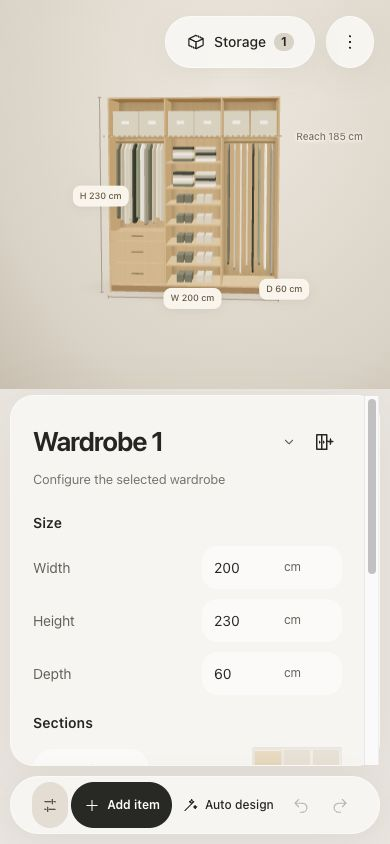
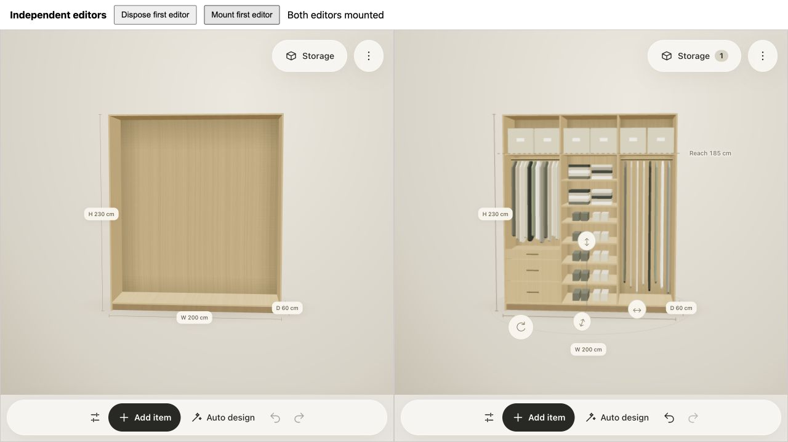
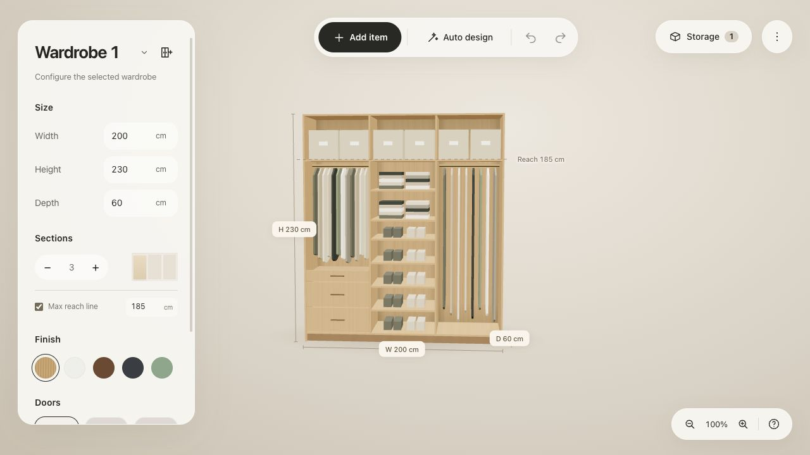
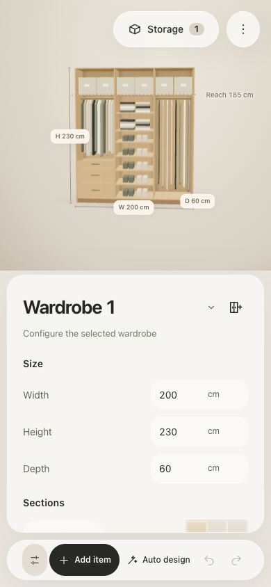
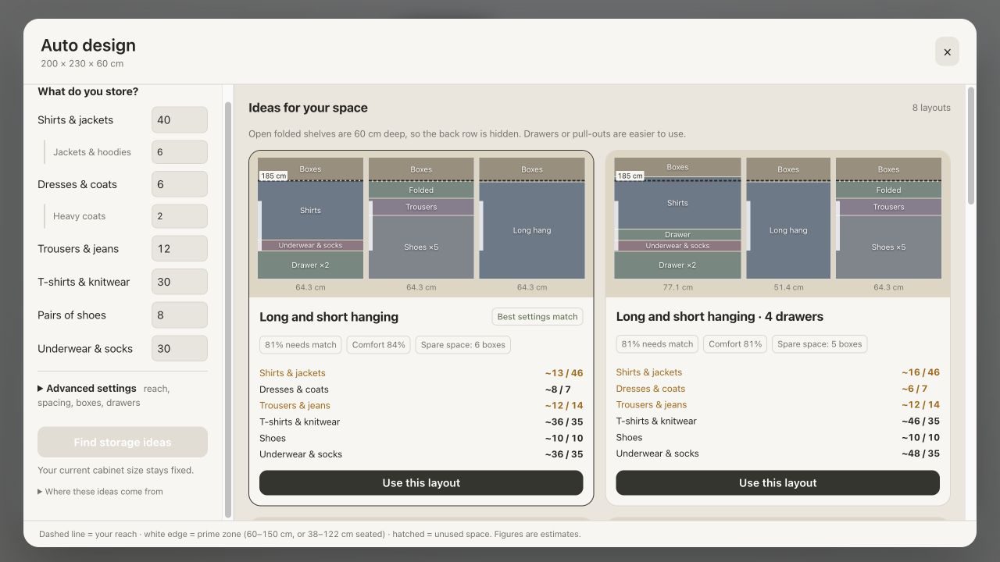
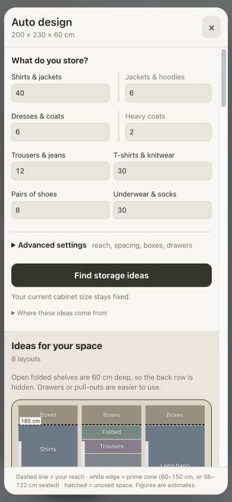

# Migration verification

The functionality supplied in `Wardrobe_Forge-4-16-12.html` now runs from the
existing layered project. The original HTML has been removed. No test or production
module loads it. The small `editor.html` Vite entry and presentation markup fragment
are required application files.

## TDD evidence

Tests were added and observed failing before implementing each migration step:

- Complete design persistence, finish overrides, validated layout metadata, stable
  identities, revision conflicts and save retries.
- Browser-free layout/movement rules, swept cabinet collisions and rejected resizes.
- Application shelf/divider/fitting commands and accessible reach constraints.
- Whole-scene history limits/redo invalidation, independent cabinet duplication,
  collision rejection and cabinet removal.
- Item edits that reject overlap and restore all placement fields.
- Camera behavior through presentation ports and viewport lifecycle cancellation.
- The concrete viewport contract and canonical selection restoration.
- Wizard startup exposed a stale cache reference during browser verification.
  A failing presenter test reproduced it before routing the cache lookup through
  the application planner service. The JavaScript type-check now catches unresolved names and dependency contract errors.
- Cabinet reset preserves the supplied editor's reach-line toggle behavior.
- The retirement test failed while the original HTML existed, then passed after
  deletion. Planner, UI markup and stylesheet hashes retain the characterized baseline.

The modularity refactor added failing tests for isolated camera/interaction state,
removal of unrestricted dependencies, immutable module connections and responsive
binding against a frozen inspector. Implementation made these tests pass. Independent
frame-clock tests and compile-time dependency restrictions supplement those checks.

Historical camera, selection, clearances, item resizing, measurement and divider
fixtures now import actual production factories. The source-reconstruction helper
was removed. Cabinet regression fixtures execute application scene commands directly.

## Automated verification

`npm run check` passes **117 tests**, dependency-boundary checks, JavaScript
type-checking of migrated modules, strict TypeScript checking of the typed layers,
and the production build. The build includes the project workspace and modular editor, with bundled
Three.js r128. Vite reports a bundle-size advisory; the build succeeds.

## Browser verification

Verified the production build at localhost:4173 after removal of the original HTML:

- Startup renders the cabinet, rulers and properties.
- Opening Auto design automatically produces eight proposals without console errors.
- Applying a proposal produces the expected three sections and 185 cm reach line.
- Undo and redo recover the empty/applied layouts.
- Add, undo, redo and remove cabinet preserve the original cabinet's fittings.
- Real keyboard input resizes a cabinet; undo restores its dimensions.
- Save project creates a local record. The project workspace opens and renames it.
- Edit wardrobe reopens the saved three-section design with its fittings and settings.
- At 390 × 844, the cabinet settings sheet and canvas remain usable. The temporary
  viewport override was reset after verification.

The verification project is named “Migration verification — modular editor” in the
preview origin's local storage. Existing development-origin projects were not edited.
The final production verification tab reported no console errors.

## Modularity verification

The final production build was also checked after the dependency and state refactor:

- Changed width from 200 to 220 cm using keyboard input; undo restored 200 cm.
- Created and removed an independent second cabinet.
- Auto design generated eight proposals; applying the first produced three sections
  and the 185 cm reach line.
- Saved a fresh browser-local verification project and reloaded its editor URL;
  the design and reach setting reopened, with fresh undo history.
- At 390 × 844, the Cabinet settings sheet opened over the rendered design.
- The production tab reported no console errors. The viewport override was reset.

The additional verification project uses ID
`a95b5868-e6e0-4e80-8fd4-094dbc3fea2c` on the preview origin. Development-origin
projects were not edited.

## Screenshots

## Scope of verification

Automated behavior tests and browser smoke checks cover the retained feature paths;
they are not exhaustive automation of every pointer gesture. Saving remains explicit
and browser-local, following the existing project service/repository contracts.

## Command, rendering and instance isolation verification

The next TDD pass added failing tests before implementing command-family extraction,
scoped IDs and keyboard ownership, dynamic control/label associations, owned-resource
disposal, and an injected live reduced-motion preference. All 116 tests pass with
layer checks, checked JavaScript, strict TypeScript and the production build.

The latest production build was verified in the browser:

- Two editors render side by side; the second retains its applied three-section layout.
- Keyboard input changes only the first cabinet's width from 200 to 230 cm.
  Its keyboard undo restores 200 cm without changing the second editor.
- Disposing the first editor leaves the second's settings functional and its layout
  intact. Remounting the first creates fresh controls and history.
- The two-editor page and a fresh saved-project tab report no console errors.
- Selecting an item opens its scoped inspector; editing and undo restore its original height.
- A new layout saves and reopens at project ID
  `90629bfb-9b9d-42b2-91c1-d5877c0fc68f` on the preview origin.
- The 390 × 844 settings sheet remains usable; the viewport override was reset.

Strict TypeScript covers all application code and the extracted renderers, mount,
DOM scope and composition root. Remaining presenters and geometry remain checked
JavaScript. The preserved planner/markup/style hashes still pass.

## Auto design layout regression

The instance-mount style adapter incorrectly matched `body` inside `.wizard-body`,
producing an invalid selector and removing desktop columns and mobile scrolling.
A failing test exercised the production style adapter against the preserved CSS;
the corrected conversion targets only the page body selector. The planner, markup
and CSS baseline files remain unchanged.

`npm run check` passes 117 tests, boundary checks, both type checks and the build.
Browser verification confirmed the 270px desktop preferences column beside ideas,
quantity changes regenerating eight proposals, applying a layout, and mobile
scrolling/application at 390 × 844. No console errors were reported and the temporary
viewport override was reset.

## Smart Auto design feature

The subsequent authorized feature intentionally changes planner box geometry and
adds measured-box/design-priority controls. Historical original hashes remain stored;
current feature hashes are reviewed separately, and styles remain unchanged. All
125 tests, type checks, dependency checks and the production build pass. See
[Smart Auto design verification and limits](smart-auto-design.md).
