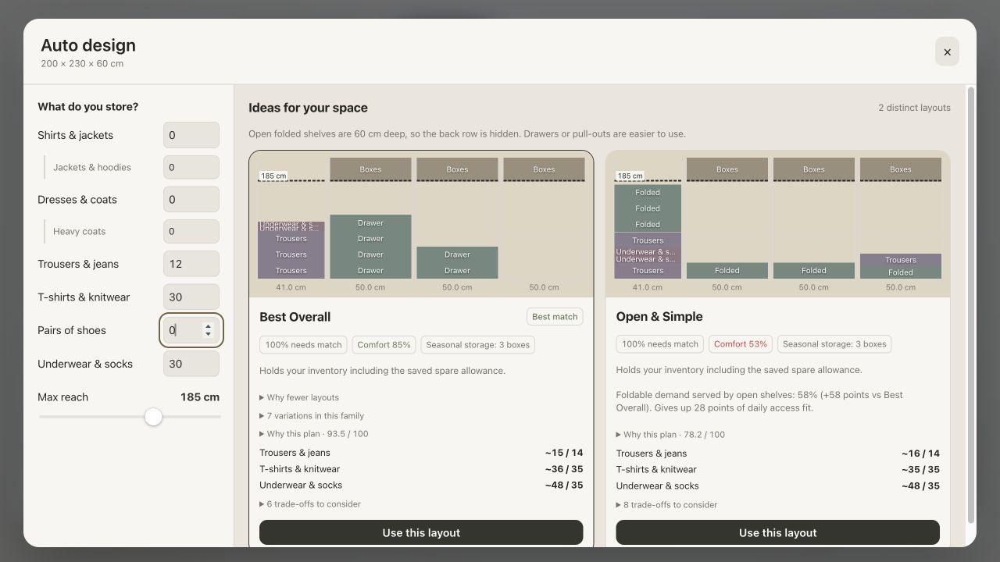

# Demand feedback and the fold-only regression

The large accessory shelves were an invented-purpose fallback: the inputs did not
request accessories, yet the finishing step added 15–65 cm accessory bays to cover
empty rectangles. Occupied-area scoring rewarded them. That fallback remains removed.

The subsequent full-assignment gate was also wrong. It required practically all
cabinet volume to be assigned even when the listed inventory could be stored in fewer
fittings. Removing filler then caused otherwise feasible inventories to receive no
recommendations. The 200 × 230 × 60 cm screenshot with 12 trousers, 30 folded items,
30 small items, no hanging/shoes and 185 cm reach reproduced this regression.

The correction keeps the existing inputs and fitting types:

- Recovery supplies only unmet inventory including saved growth. No duplicate shelves
  are added after that demand is served.
- Unrequested accessory area lowers utilisation; occupancy credit follows actual
  demand served. Multi-fitting banks must serve remaining demand.
- Abandoned space and excess capacity affect beam pruning, helping alternative
  column/fitting arrangements survive.
- Substantial unused cabinet volume is reported as unused and is not counted as
  clothing capacity. It no longer automatically rejects a feasible recommendation.
- Physical fitting, purpose-height, reach, support and quality gates remain mandatory.
- Room to Grow spare-space cards and the accessory filler fallback remain disabled.

This is deterministic search/scoring feedback, not a learning or dedicated repair
loop. The algorithm cannot prove global optimality. A cabinet larger than the listed
storage needs may retain unused volume; the planner neither invents clothing quantities
nor claims that this volume stores accessories.

The new regression requires complete proposals for the screenshot inventory, including
saved growth, with unchanged configuration and no accessory or blank spacer fittings.
Earlier gap-recovery tests now test remaining demand rather than the full inventory,
so they do not require duplicate storage for already-served clothing.

Verification: 168 tests and all architecture, JS/TypeScript and build checks pass.
The 33-case audit checks 51 proposals and reports zero hard errors. The 56 review
findings include unused volume as a design watchlist alongside capacity/reach concerns.

```sh
npm run check
npm run review:planner
node --import tsx scripts/render-planner-thumbnails.mjs docs/verification/planner-review.json
```

Production browser verification with the exact visible screenshot quantities and
185 cm reach returned two complete recommendations at 100% needs match. The test
project retains its saved box dimensions; no accessory purposes or spacer fittings
were present in the proposal descriptions, and no console errors were captured.


