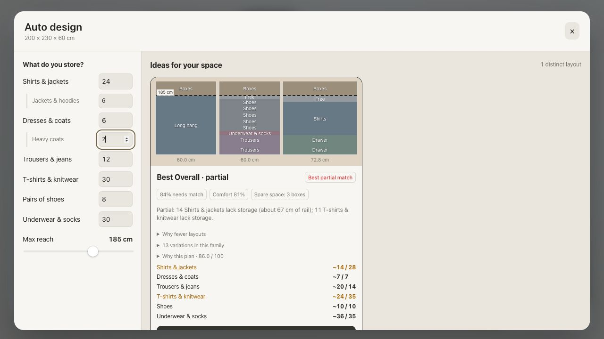

# Planner test and wardrobe design review

This review establishes a repeatable loop: generate varied wardrobes, check their
physical model independently, inspect the drawings, reproduce defects with failing
regression tests, fix the cause, and rerun the checks. Existing fitting types and
visible inventory/Max reach inputs remain unchanged.

## Verified result — 8 October 2026

- `npm run check`: 183 passing tests, architecture boundaries, migrated JavaScript
  and strict TypeScript checks, and production build.
- `npm run review:planner`: 33 configurations, 50 shown proposals, zero hard errors.
- Browser: automatic updates, applying Best Overall, empty-inventory feedback and
  restored quantities verified on the production preview; no captured console errors.
- The [current visual report](verification/planner-review.html) shows actual fitting
  positions and the review findings. The test project retains saved box dimensions,
  so its card count can differ from fixtures using default box dimensions.

The matrix includes the reported no-shoes inventory; fold-, hang- and shoe-heavy
inventories; tiny and large cabinets; single-category inventories; shallow depth;
seated reach and saved lift preferences; fixed manual fittings; saved spacing,
growth and box dimensions; and catalog-boundary garment lengths. It intentionally
includes infeasible inputs as well as successful designs.

## Defects found and corrected

| Finding | Correction and regression evidence |
| --- | --- |
| Mirroring/reordering bays changed the shared score because demand was consumed in traversal order | Allocate inventory to the most usable fittings before scoring; mirror and prime-shelf tests |
| Seasonal boxes inflated everyday accessibility | Seasonal fittings excluded from daily access; independent regression |
| A spare-space specialist abandoned clothing categories served by the reference | Preserve served categories; headline selection uses all-category candidates when available |
| Feasible shallow long hanging disappeared during beam pruning | Add a long-owning concept, preserve roles in deduplication and reserve beam slots; hand-built feasible proof plus generated-plan regression |
| Redundant sock drawers won utilisation, while a sensible single drawer failed its floor | Score useful demand and surplus fit alongside occupancy; stop surplus small-item recovery once demand is served |
| Empty/infeasible inventories received a generic quality message | Explain zero inventory, unsupported garment clearance and unreachable long rails separately |

Seven new regressions in `tests/planner-review-regressions.test.cjs` were exercised
red before the production corrections and green afterwards. Archetype floors,
hero advantage and structural diversity thresholds remain unchanged.

## What the audit actually checks

Each proposal is applied through the real design commands and independently checked
with editor geometry. The audit also checks raw, unclamped fitting rectangles for
bounds and overlaps, catalog height limits, cabinet width closure, unchanged input,
mirror score consistency, specialist hero advantage and pairwise structural distance.
Hard errors make the command fail. Thumbnails support the visual check: seasonal
bands, hanging blocks, drawer/open proportions and reserved spaces must read as
intentional layouts rather than imperceptible shelf-height variations.

A wardrobe designer would prioritize the clothing inventory and usable access before
filling every rectangle. That approach agrees with [Blum's wardrobe planning guidance](https://www.blum-inspirations.com/en-eu/knowledge/practical-wardrobe-with-interior-sophistication).
Hardware and room constraints require separate evidence: [Blum's cabinet configurator](https://www.blum.com/gb/en/services/planning-construction-product-selection/cabinet-configurator/)
handles product-specific hardware planning, while [IKEA's PAX planning guide](https://www.ikea.com/sg/en/rooms/bedroom/how-to/how-to-design-your-perfect-pax-wardrobe-pub8b76dda0/)
illustrates the importance of frame, door and room clearance. PAX-specific dimensions
are not imported as custom wardrobe rules.

## Remaining design findings

There are 26 review findings, distinct from hard geometry failures. Some layouts
supply more than twice a requested category's planned quantity. A fitting's minimum
size can explain part of this, but it does not prove every surplus layout is optimal.
These remain a watchlist for future demand-aware fitting selection and visual balance.

Very small, seated/shallow or low-reach cabinets leave entire categories unserved.
The current catalog cannot provide every long-hanging/reach combination; returned partial
cards state their shortfall. The feasibility gate preserves category coverage when
such a candidate exists in the searched pool, rather than claiming an exhaustive
proof that no other solution is possible.

The [compartment feedback](storage-compartment-limits.md) reports substantial unused
cabinet volume without inventing storage. The previous hard assignment gate was a
regression: it suppressed feasible fold-only inventory. It has been replaced by soft
search feedback, useful-capacity scoring and explicit warnings. No empty accessory
shelves or spare-space recommendation cards are reintroduced.

Zero inventory deliberately produces no card. A saved 185 cm garment drop needs
200 cm including existing hook and hem allowances, exceeding the existing long
fitting's 195 cm maximum. Those no-card cases now explain their cause.

Search is bounded, so passing this matrix is evidence against regression, not proof
of global optimality. Geometric safety/buildability ratings do not incorporate
model-specific hardware load ratings, garment weights or room-level pull-out travel.
The existing inputs do not provide those data. Depth-related shelf access remains
penalized; adding a shelf does not make its hidden back row comfortable to use.

## Rerun and extend the loop

```sh
npm run check
npm run review:planner
node --import tsx scripts/render-planner-thumbnails.mjs docs/verification/planner-review.json
```

Inspect `docs/verification/planner-review.html`; the JSON contains the complete
case configurations, geometry, criteria and findings. Review warnings require
judgment and do not silently fail the build. For a new defect, add its envelope and
inventory to `tests/fixtures/planner-review-cases.cjs`, write a failing assertion
about the missing behavior, make the smallest domain correction, run the commands
above, then verify the drawing and application flow in the browser.



The [demand-feedback correction](planner-demand-feedback.md) supersedes the accessory
finishing fallback. Current counts reflect the stricter inventory-supported contract.

The [optimization diagnosis](planner-optimization.md) supersedes the requirement
that every partial fallback must clear a comfort floor. Latest automated results:
175 tests, 33 configurations, 52 proposals, zero geometry errors. Browser verification
above describes the earlier UI pass; the optimization changes were verified through
the domain tests and real proposal-application geometry audit.

The [purposeful-layout correction](purposeful-wardrobe-layouts.md) supersedes the
prior policy of accepting large unused spaces. Current results are 183 tests and
50 proposals; the audit now fails on unassigned usable compartments.
