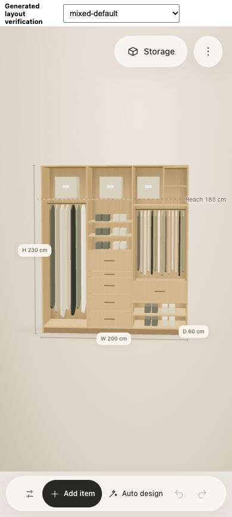

# Purposeful cabinet completion

The screenshot exposed a product requirement the earlier optimization did not meet:
a wardrobe is a furnished cabinet, not only a set of fittings that satisfies an
inventory vector. A warning beside a large abandoned shaft is not a design solution.
This policy supersedes the earlier requirement to leave all surplus space empty.

## Corrected causes

- Inventory recovery stopped once the requested counts were met. Generated cabinets
  now have a separate envelope-completion stage after inventory and seasonal storage.
- Rectangle subtraction fragmented otherwise contiguous clear space. Recovery and
  completion now merge adjacent clear rectangles before measuring fitting feasibility.
  Gaps separated by a real divider are never merged.
- Search-created cuts survived after their neighboring storage was abandoned.
  Unsupported cuts are removed; cuts adjacent to existing fitting edges remain.
- The 40-action beam budget incorrectly prevented large cabinets from being fully
  furnished. Search remains bounded; envelope finishing has a separate 128-part
  guard and cannot consume extra search actions.
- Clothing could remain at the floor beneath unused prime-height space. A bounded
  adjacent-compartment rearrangement moves an entire daily bank together when this
  improves its score, preserves inventory coverage and passes all physical checks.

## Meaning of remaining space

Generated clear rectangles at least 25 cm wide and 15 cm high receive real adjustable
shelf compartments, targeting about 32 cm height and never exceeding 40 cm. Wide
rectangles get supporting vertical boards before shelves are fitted. The new
`reserve` purpose is presented as **Adjustable storage**, not as assumed possessions.
It contributes no clothing or seasonal-box capacity and renders without fictitious
contents. Above-reach compartments are explicitly described as occasional storage.
Existing measured seasonal boxes retain their own limits and counts.

Adjustable storage is modestly credited for useful occupied space, while coverage
still reflects only the user's clothing. The original physical constraints remain:
width, depth, height, overlaps, fitting limits, daily reach and lift opt-in. Manual
layouts are not rearranged or automatically filled.

This is a bounded completion and improvement algorithm, not a proof of the global
optimum. Tiny clearances and physically unusable strips may remain and are reported;
generated candidates with an unassigned usable compartment are rejected before
recommendation, and the independent audit enforces the same invariant.

## Verification

- `npm run check`: 183 passing tests, architecture boundaries, editor/TypeScript
  checks, and production build. The existing bundle-size advisory remains.
- `npm run review:planner`: 33 configurations, 50 displayed proposals, zero geometry
  errors and zero unassigned shelf-sized gaps in generated layouts. The 26 remaining
  review findings concern small unused clearances, surplus capacity or unserved
  categories in constrained inventories.
- Tests cover tall gaps, supported wide shelving, space-fragment merging, fixed
  geometry, capacity honesty, moving clothing toward prime reach, idempotent finishing
  for the tested case, and applying/saving/reopening the new purpose.
- Real browser: generated and applied Best Overall in the isolated 3D editor;
  inspected mixed and fold-only inventories with no captured console errors.

[Interactive local verification](http://127.0.0.1:4175/docs/verification/envelope-preview.html)
uses the real editor with the audited proposals and does not write a saved project.

