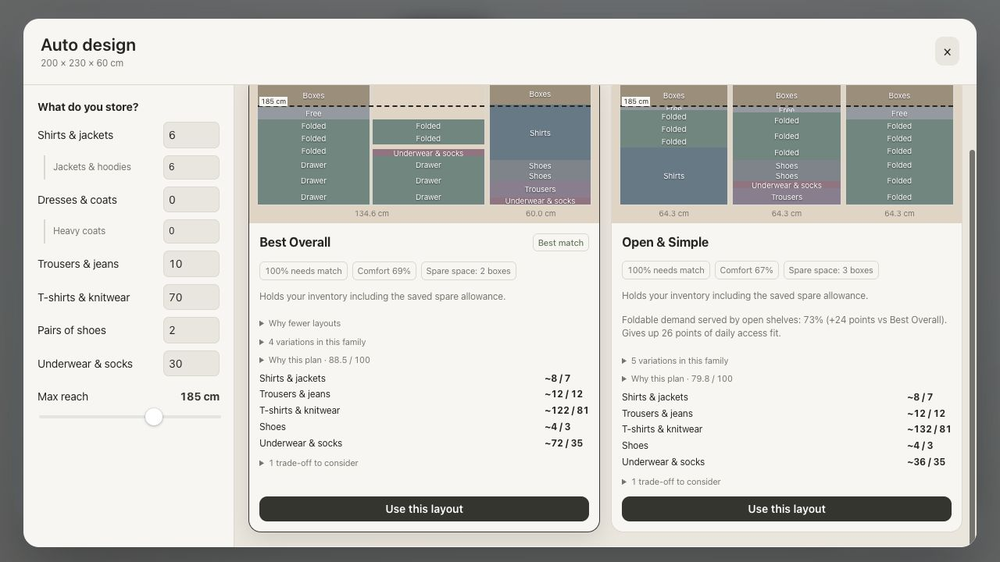

# Inventory-ranked design gallery

The gallery now targets eight selectable designs, ranked consistently by current
possession fit. This supersedes the four-card specialist selection policy documented
below. Existing geometry, reach, catalog and fixed-fitting constraints still apply.

- Rank current inventory completeness first, then mean coverage across requested
  categories, then the weakest category. Category ratios cap at 100%, so surplus
  capacity cannot compensate for a shortage elsewhere.
- Next rank growth completeness and growth coverage, then shared design quality
  and existing deterministic construction tie-breakers.
- Keep the strongest inventory match. Prefer structurally different candidates
  within five coverage points, then fill remaining slots with meaningful family
  variants. All selected cards are sorted again by the same inventory ranking.
- Deduplicate structural keys (including mirrors and minor fitting changes), and
  require at least 0.025 DNA separation for selectable variants. The existing 0.20
  threshold distinguishes broad families, rather than suppressing useful variants.
- If fewer than eight are available, search individual bay counts independently,
  preserving earlier candidates. Constrained inventories can still produce fewer;
  no physical rules or user dimensions are relaxed to meet the count.
- Cards use tags for rank, current fit, growth fit, bay count, access, quality,
  family variants and shortages. Capacity rows show fits / owned / growth.
  Warnings remain available on focus and hover via a trade-off tag.

Validation: the four standard inventory envelopes produce eight designs. The tiny
80 cm cabinet produces seven after enforcing a 12 cm generated sock-drawer minimum.
Previews distinguish above-reach reserve storage from folded clothing and show actual
compartment heights. The earlier
33-configuration application/geometry audit checked 207 designs with zero hard
errors and 65 review findings (including partial inventories and unused clearances).

## Changing sections on an existing design

The + button splits the selected section; − merges it with the adjacent section
(right when available, otherwise left). Changes apply immediately and create one
undo entry. The status toast includes an Undo action and the resulting inventory fit.
A detached calculation first preserves fitting identities, heights and finishes,
resizing or restacking only affected sections. If this cannot satisfy physical rules
or preserve custom cuts, the planner regenerates the requested exact section count
using the same dimensions and possessions. If no valid proposal is found, the
current wardrobe and undo history remain intact. Empty wardrobes change count directly.

---

# Auto design: archetypes and structural diversity

The [purposeful cabinet completion](purposeful-wardrobe-layouts.md) update supersedes
the old surplus-space policy below. Generated cabinets receive explicit adjustable
storage, and recovery coalesces fragmented clear rectangles before fitting them.

Auto design uses the existing fitting catalog and inputs. Inventory quantities,
jackets/coats subcounts and **Max reach** remain unchanged. Input edits regenerate
ideas automatically. Saved planning preferences, measured boxes and growth allowance
are preserved. Search works in millimetres and returns the existing centimetre model.

The latest spec replaces eight headline alternatives with **Best Overall plus up to
three specialists**. Similar plans are grouped as variations instead of padding the
results. A constrained wardrobe can legitimately show one layout or none.

## Confirmed diagnosis

The prior top-ten DNA dump is saved in
[planner-dna-before.json](verification/planner-dna-before.json). The first two plans
have identical area shares: hanging 57.4%, drawers 20.4%, open shelves 3.2%.
Their DNA distance is 0.06, below the 0.20 family threshold. Other pairs also share
almost identical proportions. The pool was not entirely identical, but its headline
results contained the sibling collapse described in the spec.

## Planning pipeline

1. Build category demand including saved growth. Subtract existing explicitly
   positioned manual fittings and actual divider boards from the cabinet.
2. Run an independent deterministic search for each applicable archetype. Candidate
   generation is cached across these beams for the same envelope and demand.
3. Pick coarse concepts first: bounded column counts, natural width patterns and
   the block reserved for folding or hanging. Keep concept quotas during pruning.
   Then select exact fittings and heights inside each concept's roles. When long hanging
   is feasible, reserve beam capacity for a long-hanging concept; deduplication keeps
   different roles even when their starting rectangles match.
4. Apply physical gates, archetype module restrictions and concept-role gates.
   Search the most constrained rectangles first, branching on fittings, existing
   divider cuts and leaving space clear. Preset-height and capacity-breakpoint searches use independent beams so new
   candidates cannot crowd out existing preset paths. Each beam holds 32 states, bounded to
   48 steps and 40 fittings/cuts. Its module bias affects search; hero metrics lead
   final specialist ranking, with archetype weights resolving ties.
5. Recover usable gaps before seasonal storage. Serve missing demand first. Then
   complete the cabinet with bounded adjustable-storage compartments, separately
   labeled and excluded from clothing and box counts.
   Daily Driver and Room to Grow preserve reserve capacity during demand recovery.
   The final compartment assignment step must still fit bounded storage to remaining
   usable rectangles. Finalize seasonal bands/slivers only when physical gates remain valid.
   Manual fixed geometry is never moved.
6. Normal candidates pass all six quality floors (0.45). If none pass, a separate
   balanced search retains physically valid candidates that serve actual inventory,
   with explicit quality warnings. Complete plans retain priority; partial plans
   rank by inventory coverage before the shared balanced score. If the pool can serve every requested category, headline
   selection preserves that category coverage. No private archetype score is
   presented as that score.
7. For each archetype, take its highest hero metric. Show it only when it beats the
   reference by at least 15% and is at least 0.20 DNA distance from every shown plan.
   Specialists must also retain each category served by the reference. Sort
   specialists by relative advantage and stop at three.
8. Explain the hero metric's percentage/point gain and the measured cost, coverage
   or criterion trade-off. Explain rejected/skipped approaches when fewer pass.
   Group sibling variants under a collapsed family explanation.

## Archetype table

| Archetype | Hero | Structural rules / applicability |
|---|---|---|
| Best Overall | Shared balanced score | Flexible concepts; existing physical gates |
| Daily Driver | Daily access fit | At least 25% foldables; folding block; folded/trouser/small-item interaction in prime reach band |
| Drawer First | Foldable demand served by drawers | At least 25% foldables; drawers enabled; no open folded/trouser shelves; folding block |
| Open & Simple | Foldable demand served by open shelves | Folded/trouser demand; no full drawers/baskets; folding block |
| Hanging Focus | Hanging demand served | Short-hang demand, tall cabinet and sufficient reach; hanging block and a double-hang stack |
| Room to Grow | Disabled | Saved growth is included in real category demand; no spare-space cards |

Hero storage metrics cap each category at its requested quantity: excess sock
capacity cannot impersonate served T-shirt demand. Accessibility is the shared
frequency/reach/depth score, not a claim that a particular percentage of actual
clothes sits between two exact heights. Reserved space includes unused/void area.

## DNA and shared scoring

DNA records area shares for hanging, drawers, open shelves, shoes, seasonal storage
and spare space; column count and quantized width pattern; and the reach-band
location of each category. Distance is a weighted normalized L1: type shares 55%,
columns/widths 25%, category zones 20%. Sorted width patterns and aggregated shares
ignore mirrored column order. Heights are quantized to the fitting pitch so small
height changes cannot create new families.

Manual layout ratings and proposal ratings use the same six normalized criteria:
accessibility 30%, clearance 20%, utilisation 15%, grouping 15%, safety 10%, and
buildability 10%. Existing saved storage-priority weights remain supported. Bay
autofill shares the search and preserves fixed fittings/dividers while deducting
storage supplied by other bays. Applying a proposal retains its actual cuts.

Inventory is allocated to the best usable fittings before scoring, independent of
left/right order. Seasonal storage cannot inflate daily accessibility. Utilisation
combines demand served (50%), demand-supported occupied area (20%) and a surplus-capacity fit (30%),
with an additional penalty for unrequested area. computed over requested categories. Recovery stops adding small-item drawers once
that demand is met; a full cabinet is not automatically a useful cabinet.

## Module ownership

- `storage-fitting-limits.ts`: purpose-aware minimum/maximum compartment heights.
- `storage-compartments.ts`: generated-gap finishing and assignment validation.

- `design-archetypes.ts`: applicability, weights, floors, gates, bias and concepts.
- `selection-planner.ts`: archetype orchestration, reference, margins and family selection.
- `design-hero-metrics.ts`: category-capped hero measurements.
- `layout-dna.ts`: structural fingerprint and distance.
- `selection-search.ts`: per-archetype detail beam and candidate cache.
- `selection-config.ts`: millimetre rules and search bounds.
- `selection-spaces.ts`: clear-space subtraction and cabinet partitions.
- `selection-modules.ts`: existing fitting candidates and local benefit density.
- `selection-recovery.ts` / `selection-finalize.ts`: validated recovery and finishing.
- `layout-score.ts` / `board-schedule.ts`: shared gates, scoring and board explanations.
- `wardrobe-planner.js`: preserved numerical capacity and geometry oracle.
- `wardrobe-composer.ts`: compatibility facade and existing composition helpers.
- `application/projects/planner-service.ts`: per-editor configuration-keyed cache.

## Verification

The expanded [test and design review](planner-design-review.md) covers 33
configurations and 50 shown proposals, including independently checked application
geometry, mirror scoring, single-category inventories and shallow wardrobes.
[Current visual report](verification/planner-review.html) includes the remaining
review findings. Run `npm run review:planner` to refresh its JSON; rendering
instructions are in the review document.


`npm run check` passes **183 tests**, architecture boundaries, JavaScript and strict
TypeScript checks, and the production build. Tests cover deterministic output,
existing catalog/inputs, fixed geometry, application/serialization, mirrored DNA,
family grouping, floors, hero margins and the five requested inventory envelopes.

[Five-inventory results](verification/planner-archetype-results.json) contain scores,
heroes, floors, geometry and pairwise distances. Reproduce them with:

```sh
node --import tsx scripts/planner-diagnostics.mjs > docs/verification/planner-archetype-results.json
node --import tsx scripts/render-planner-thumbnails.mjs
```

The [thumbnail comparison](verification/archetype-thumbnails.html) renders actual
positions for the squint test. Folding/drawer proportions, column patterns and
reserved blocks differ visibly; the tiny wardrobe has only the reference.

Production browser verification confirmed automatic updates with unchanged controls,
family explanations, measured specialist trade-offs and applying Open & Simple
without console errors. The preview test project retains its saved box dimensions
and jacket count, so its fold-heavy example produces two qualifying cards rather
than the diagnostic fixture's three.



## Limits

Search is bounded and cannot prove global optimality. A missing specialist means
no eligible candidate cleared every gate, floor, advantage and diversity test.
Generated layouts complete usable gaps with adjustable storage. Small unusable
clearances are reported; the audit rejects abandoned shelf-sized compartments. See
[storage compartment limits](storage-compartment-limits.md). Room to Grow is disabled for recommendations; saved growth remains included in
category demand. A demand-only concept beam supplies additional balanced candidates.
See [demand feedback](planner-demand-feedback.md) for why unrequested shelves are rejected.

Safety/buildability use geometric rules. Existing inputs do not provide room-level
pull-out clearance, hardware load certification or per-item weights. Clothing is
illustrative. The planner cannot certify installation safety from missing data.

See [optimization diagnosis](planner-optimization.md) for the ranking, no-result,
height-candidate and bounded-search corrections and remaining design work.
