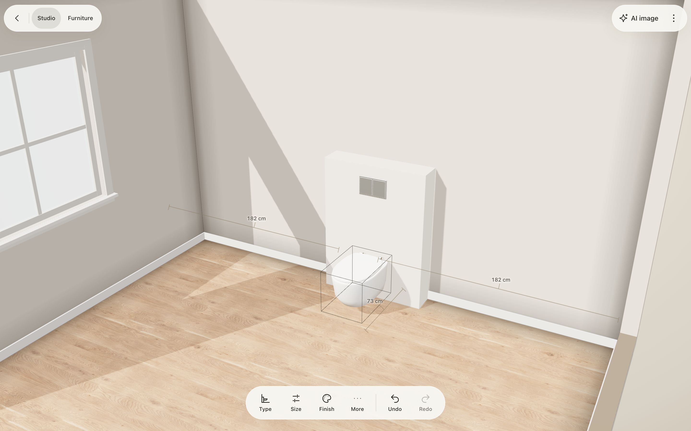
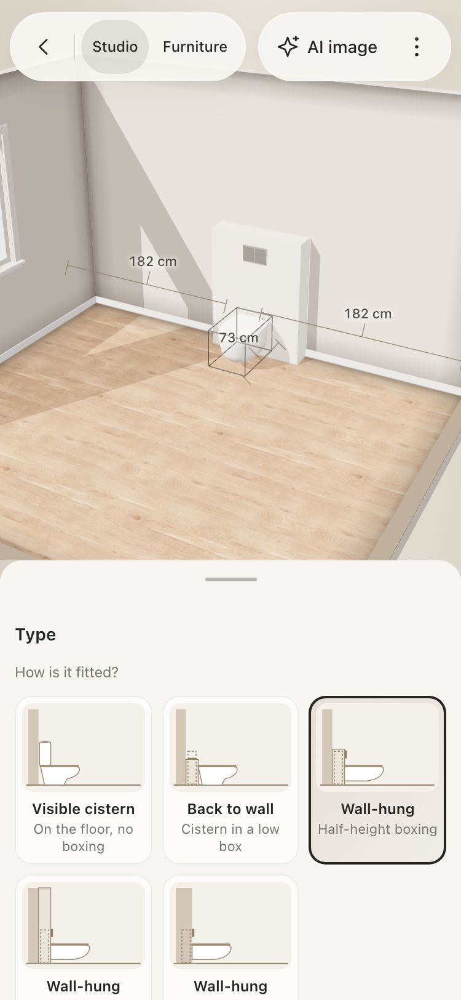

# Studio fixtures: toilets, basins and what stands behind them

Fixtures are what is built into a room and plumbed in: a toilet, a basin. They stand against a wall in Studio,
are edited like the room's other parts, and are obstacles for every piece of furniture.

## How it works for a person

- **Add**: Studio › **Fixtures** (toolbar), or a selected wall's **Add › Fixtures**. It goes on the selected wall, else the
  wall in view where the view looks, at the nearest free spot (never in a doorway, under a low window sill, in another
  fixture or where furniture stands). The view turns to it and it is selected.
- **Selected fixture**: **Type · Size · Finish · More** (Duplicate, Remove). Delete removes it, arrow keys slide it 1 cm
  (10 with Shift), Escape lets go.
- **Type**: how it is fitted, as pictures. A toilet has five setups: visible cistern; back to wall (cistern in a low box);
  wall-hung in a half-height boxing; wall-hung in a full-height wall; wall-hung with its frame in the wall. A basin has
  four types (wall-hung, pedestal, vanity unit, countertop bowl) and its tap on the basin or on the wall.
- **Size**: width, depth (from the boxing or the wall it stands against), seat or rim height, and the gaps to each end of
  the wall. Each is also typed by tapping its ruler on the model.
- **Finish**: ceramic (gloss white, matt white, stone grey, matt black), metal for taps and flush plates (chrome, brushed
  steel, brushed brass, matt black), and the cabinet of a vanity (white, oak, walnut, sage, charcoal).
- **Drag** it by its body along its wall. It lines up with the wall's middle, a window, a boxing, the advised 20 cm from a
  wall, and its neighbours (Shift moves freely); it goes as far as the room allows and says why it stopped.
- **On the model**: the gaps to its sides, how far it stands out from the wall in all (boxing and bowl), and the free
  floor in front of it, amber when less than a person needs (60 cm for a toilet, 70 for a basin).

## The plaster wall: a boxing is part of the room

A wall-hung toilet hangs on a frame that holds its cistern. The frame is inside a boxing (half or full height) or inside a
stud wall; a back-to-wall toilet hides its cistern in a low box. The boxing is **not a toilet setting**: it is a
floor-standing shape on the wall (`ceilings` with an outline, the same as a pillar; also in the Ceiling picker as
**Boxing**), so it is sized, reshaped and painted like any other part of the room.

A fixture stands against **whatever is in front of its wall where it is**: `fixturePlace` finds the deepest shape covering
its span at its height, and its back stands on that shape's face. Nothing links the two, so:

- a deeper boxing brings the toilet forward; widening one along the wall lets a basin stand in front of it too;
- choosing a setup builds, raises, lowers or removes the boxing behind it (`applySetup`). A boxing another fixture stands
  against is shared construction: it is never removed for one of them, and the note says so;
- sliding a toilet takes its own boxing with it (`slideFixture`), as the frame inside would go; a shared boxing stays and
  the toilet slides along its face;
- the setup shown is read back from the room (`currentSetup`), so it is always true to what is built.

## Code

| Concern | Place |
|---|---|
| Kinds, types, setups, finishes, taps (the registry) | `src/domain/studio/fixtures/fixture-kinds.ts` |
| Where a fixture stands, its solid, the shape behind it | `fixtures/fixture-place.ts` |
| Edits (add, move, size, type, finish, remove, wall edits) | `fixtures/fixture-edit.ts` |
| Setups, boxings, sliding with a boxing | `fixtures/fixture-setup.ts` |
| Rules (worded as what to do) | `fixtures/fixture-validation.ts`, called from `studioProblems` |
| Commands (one undo step each, refusals with reasons) | `src/application/commands/fixture-commands.ts` |
| Saving | `studio.fixtures` (absent when none), `src/infrastructure/serialization/fixture-schema.ts` |
| 3D models | `src/presentation/viewport/fixture-toilet.ts`, `fixture-basin.ts` (lofted ceramic, `fixture-geometry.ts`), `fixture-views.ts` |
| Dragging, alignment and rulers | `src/presentation/editor/fixture-editor.ts`, `fixture-drag.ts` (alignment through `resolveAlignment`) |
| Type and Finish panel, drawings | `fixture-panel.ts`, `fixture-art.ts`, `fixtures.css` |
| Plan drawing | `src/domain/drawings/fixture-plan.ts` (footprints, centre lines, boxings cut and hatched) |

### Adding a kind (a bidet, a shower tray, a bath)

1. One entry in `FIXTURES` (`fixture-kinds.ts`): types with sizes, limits and their solid's `extent`; setups if a boxing
   is part of how it is fitted; height label; free floor it needs; finish groups.
2. Its model in `MODELS` (`fixture-views.ts`) and its card in `CARDS` (`fixture-art.ts`): both are typed by the
   registry key, so a new kind does not compile without them.
3. `tests/architecture/studio-fixtures.test.ts` and `studio-fixture-models.test.ts` walk every kind, type, setup, finish
   and tap: buildable in a room, saved and read back, a model inside its own solid, drawings for every choice.

## Verification

`npm run check`, then `node scripts/check-studio-fixtures.cjs` with the dev server at 127.0.0.1:5173 (or
`MOBILE_TEST_URL`): adds a toilet from a wall's Add, changes its setup and undoes it, slides it, types its seat height,
changes its finish, removes and restores it, and adds a vanity basin, on a desktop and a phone (375 px). Screenshots go to
`docs/verification/studio-fixtures/`.

## Not done yet

- More kinds: shower tray and screen, bath, bidet, washing machine, towel radiator, and flat wall items (mirror, towel
  rail, roll holder) as wall utilities.
- A fixture moves along its wall only; to put it on another wall, add it there.
- Design specs and the agent API (`window.furnidraw`) do not build fixtures yet.
- Elevations do not draw fixtures; the plan does.
