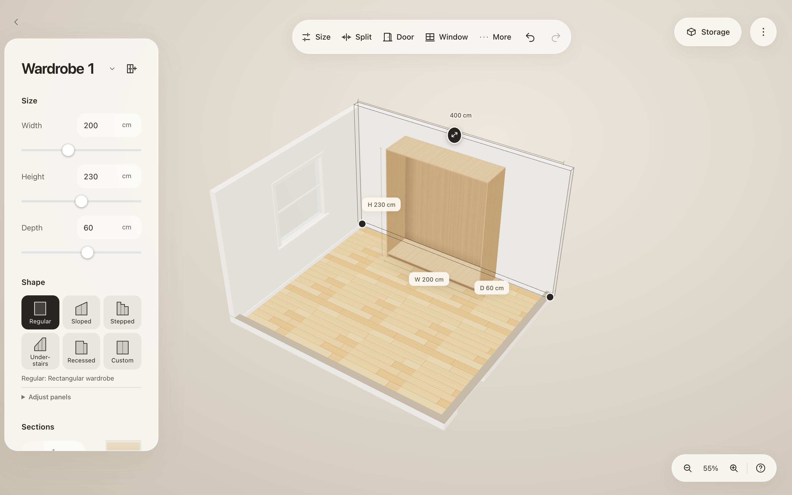
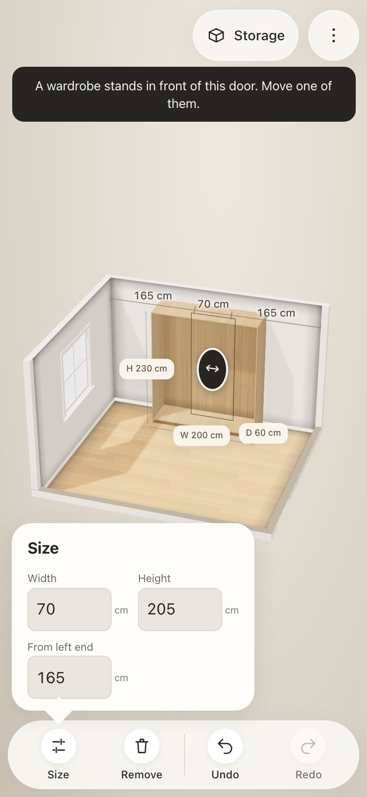

# Studio: development notes and handoff

Branch: `feature/studio` (from `main` at `2f3fcbf`). Not merged into `develop` or `main`.
Read `CLAUDE.md` first: commands, layer rules, guards, and how we work.

## What the user asked for

A **Studio**: the room the wardrobes stand in, as close to the real room as possible.

- Built-in studios, plus custom studios built by arranging and resizing walls.
- **UX is the most important thing**: selecting, building, resizing, camera moves, near-real UI
  elements and physics. Follow the app's existing easy-to-use, easy-to-edit approach.
- Later (not this branch): build the studio from a photo of the real room. The research is in
  `docs/studio-investigation.md`. That file is **untracked and not ours** (another session wrote it):
  read it, do not commit or edit it.

The user expects: test before saying something works, send screenshots as evidence (desktop and
phone), no noisy UI (no label backgrounds, no overlapping text), never claim done unverified.

## Design decisions (keep them)

- **One coordinate frame.** Studio corners use scene x/z in centimetres, the same as a wardrobe's
  position. A wardrobe's x/z is its centre; at angle 0 its back is at -z and its front faces +z.
- **Corners and walls.** A wall runs from corner `a` to corner `b`, centred on that line. Its
  **room side** is to the left of a→b: normal `(nx, nz) = (-uz, ux)`. That equals the front
  direction of a wardrobe at the wall's angle `atan2(-dz, dx)`, so a wardrobe flush against a wall
  simply takes the wall's angle. Moving a corner stretches every wall that meets there.
- **Openings** (door, window, archway) belong to a wall: `offset` is the distance from corner `a`
  to the opening's centre. Wall and corner moves keep openings where they are in the room
  (`keepOpenings` in `studio-edit.ts`).
- **Edits are pure functions** (`studio-edit.ts`) returning a new studio. The application command
  `editStudio(edit, recordHistory)` validates with `studioProblems` and refuses walls that would cut
  through a wardrobe, reporting the reason. A drag uses `recordHistory: false` for live previews and
  takes **one** checkpoint when it starts (copy the shape editor's pattern in `shape-inspector.ts`).
- **Physics**: walls are obstacles in the same collision rules as wardrobes
  (`createCabinetGeometry(getCabinets, getObstacles)`; adapter `studio-obstacles.ts`). Dragging,
  turning, resizing and reshaping wardrobes already stop at walls. Scene bounds stay wardrobe-only.
- **No room by default.** New and old projects have no `studio`. The golden tests must stay
  untouched by every studio commit.
- **Built-in studios are a registry** (`studio-templates.ts`): one entry each, laid out around the
  wardrobe wall (x = 0 is its middle; the back wall's room face is at z = 0). Picker art is drawn
  from the corners, so a new built-in needs no art.
- Sloped ceilings and boxes under stairs (the user's photo) are **not** in v1. Add them as new lists
  on `Studio` (for example `ceilings`), not as new wall fields. Do not offer an under-stairs studio
  until slopes exist.

## Files

| Layer | File | What it does |
|---|---|---|
| Domain | `src/domain/studio/studio.ts` | Model, limits, defaults, `wallLine`, `wallBox`, `wallExtent`, `wallFace` (inside length), `studioBounds`, `nextId` |
| Domain | `src/domain/studio/studio-templates.ts` | Built-in studios registry: wall, corner, alcove, bedroom, walk-in |
| Domain | `src/domain/studio/studio-edit.ts` | Edits: move corner or wall, inside length, size, split, extend, merge corners, suggest a wall, openings, translate |
| Domain | `src/domain/studio/studio-validation.ts` | `studioProblems` (worded as what to do), `openingRange` |
| Domain | `src/domain/studio/studio-obstacles.ts` | Walls as collision obstacles |
| Domain | `src/domain/studio/studio-placement.ts` | `placeAgainstWall`, `pushOutOfWalls`, `snapToWall` |
| Application | `src/application/commands/studio-commands.ts` | `placeStudio`, `editStudio`, `studioProblem`, `addStudioWall`, `addStudioOpening`, `placeNewCabinet`, `wallSnap` |
| Presentation | `viewport/studio-renderer.ts`, `studio-surfaces.ts` | Walls, openings, floor, ceiling; cutaway (walls lower to a cut stub); selection outline; wardrobe snap strip |
| Presentation | `viewport/studio-overlay.ts` | Room handles, live rulers, guides, refusal reasons in the label system |
| Presentation | `editor/studio-editor.ts`, `studio-drag.ts` | Room selection, drags (corner, wall, opening, "+"), snapping, measures, toolbar commands |
| Presentation | `editor/studio-fields.ts` | Size popover fields (wall: length inside, height, thickness; opening: width, height, sill, from left end) |
| Presentation | `editor/studio-panel.ts`, `studio-art.ts` | Walls category of Add item (desktop fold `#padd-room`, phone category `room`) |
| Presentation | `editor/room-wiring.ts`, `studio.css` | Wiring, keys (Esc, Delete), room framing; styles |
| Tests | `tests/architecture/studio*.test.ts`, `scripts/check-studio.cjs` | Model, physics, editing; real UI flows on desktop and phone |

## Status

| Slice | State |
|---|---|
| 1. Domain model, built-in studios, edits, validation | **Done** |
| 2. Walls as obstacles, room placement, new wardrobes inside the room, wall snap, saving | **Done** |
| 3. Rendering, Room picker, cutaway, camera framing, drag snap | **Done**, verified desktop and 375 px |
| 4. Editing UX: select and change walls, corners, openings | **Done**, verified desktop and 375 px |

`npm run check` (354 tests), `npm run check:mobile` and `node scripts/check-studio.cjs` pass (the last two
need the dev server at 127.0.0.1:5173). Golden fixtures are unchanged.

How it works now:

- **The toolbar and Add follow the selection, from the outside in** (`contextual-actions.js`, `bindMoreBtn` in
  `shell-bindings.js`, `selectionState.addScope`):
  - Nothing selected is the room: toolbar **Add**, Undo, Redo (Auto design hidden). Add opens "Add to the
    room" (`#pop2[data-scope="room"]`): Wardrobes (and shapes), and Walls, doors and rooms (Wall, Door, Window,
    Archway, built-in rooms). It does not select a wardrobe or move the camera.
  - A wardrobe (or a space in it): toolbar Add item, Auto design ("Design" on phones), Move, Resize, More
    (Sections, Shape, Material, Reach, Doors, Add wardrobe, Duplicate, Reset, Remove). Add item opens fittings
    for the selected space only, with "‹ Room" to go up a level.
  - An item, a wall or an opening: their own actions, as before.
  The Room section left the wardrobe panel. Wardrobe name labels stack instead of covering each other.
- **Click or tap a wall** (when no wardrobe is in front of it) or an opening to select it. The contextual
  toolbar shows its actions on desktop and phone: wall → Size, Split, Door, Window, More (Archway, Add wall,
  Remove wall); opening → Size, Remove. Size opens exact fields. Esc leaves, Delete removes.
- **Handles**: corner dots (floor), a grip on the wall's top edge (moves it along its room side), "+" on free
  ends (drag to draw a wall, click for a right-angle wall), a grip on each opening (slides it). Drags go as far
  as the room allows and say why they stopped; one undo step each; Shift drags freely. Snaps: corners square
  with neighbours, align with other corners, 45°, and join a free end dropped within 36 cm of another free end;
  walls align with corners; openings centre on the wall.
- **Lengths are inside lengths** (`wallFace`), as a tape measure reads them. Setting one moves the next wall
  square, so a room grows instead of skewing.
- **Cutaway**: walls between the camera and the room lower to a 14 cm stub with a darker cut top (no ghosting).
  The selected wall keeps a full-height outline. The ceiling shows only from inside the room.
- **Camera in a room**: the camera goes exactly where the person moves it, with or without a room; the room never
  moves, clamps or re-aims it (an earlier version kept eye-level views inside the room with a wider lens and a
  45° stop, which looked good in stills but fought pinch, orbit and pan on phones; it was removed). Walls between
  the camera and the room are cut away, to a 14 cm stub from above and a line on the floor near eye level.
  Selecting a wall seen from behind swings the view round to it. Right- or middle-drag, Shift-drag on empty
  space and two fingers pan (vertical moves pan up and down at eye level, along the floor from above), kept
  near the room without ever jumping. A project with a room opens on the whole room.
- **Wardrobes in the way**: while a wardrobe is selected, another one between it and the camera is hidden and
  shown as a dashed footprint (`viewport/wardrobe-occlusion.ts`).
- **Wardrobe drags** follow the pointer in 1 cm steps (were 5 cm); a green strip marks the wall face a wardrobe
  snapped to.

## What is left

- Corner and opening fields have no keyboard-free precise X/Z entry (corners move by dragging or arrow keys).
- Removing a corner (merging two collinear walls into one) is not offered.
- `check-studio.cjs` taps the back wall at a fixed point of the framed view; if framing changes, update `VIEWS`.
- Walls meet only at corners: a wall cannot start from the middle of another (split it first).
- Phone gestures were checked with synthetic touches (one-finger orbit, pinch, two-finger pan) in Playwright,
  not on a real phone.
- Later: sloped ceilings and boxes (from the user's photo), "fit a wardrobe to a niche", wall materials,
  lighting, photo-assisted building.

## Gotchas

- **Architecture ratchet**: `npm run check:architecture` fails on files over 400 lines, lines over
  240 characters, hand-written kind or possession lists, and HTML in the domain. Older files are held
  at their size in `scripts/architecture-baseline.json`. `inspector-presenter.js` is at its limit
  (439 lines): add nothing to it, put new UI in its own module.
- **Hash-locked files**: `editor.html`, `editor.css` and `wardrobe-planner.js` are hashed in
  `tests/fixtures/editor-baseline.json`. Refresh the hash in the same commit and say why. Prefer
  styling in `shape.css` and new CSS files.
- **Golden tests** must stay untouched: a scene without a studio must behave exactly as before.
- Tests construct `createCabinetRenderer` with partial fakes, so the studio renderer is optional there.
- New ports go in the matching `.ports.d.ts` (for example `editor-gestures.ports.d.ts` got `wallSnap`).
- Commit messages end with the attribution line the session gives. Push only this branch; merge
  into `develop` or `main` only when the user asks, by fast-forward.
- Once, this checkout switched from a feature branch to `main` without any command of ours. Check
  `git branch --show-current` before committing.
