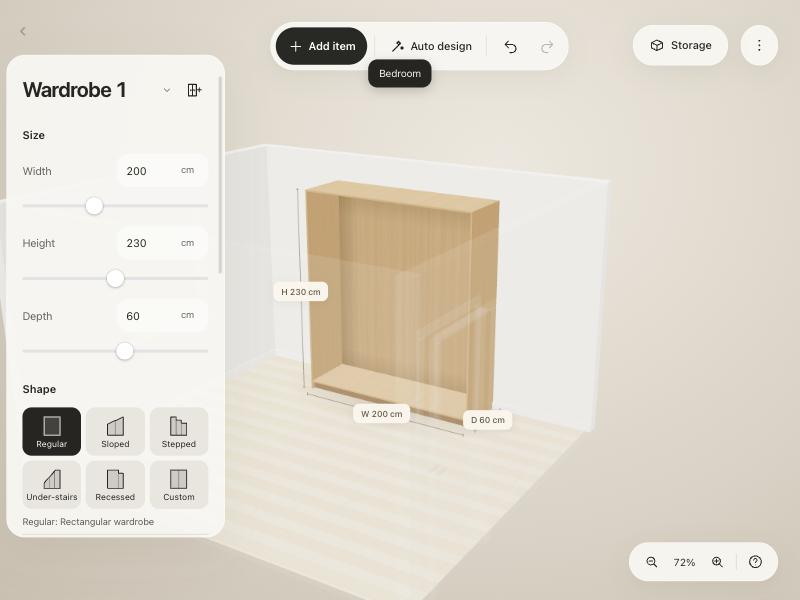

# Studio: development notes and handoff

Branch: `feature/studio` (from `main` at `2f3fcbf`). Not merged into `develop` or `main`.
Read `CLAUDE.md` first: commands, layer rules, guards, and how we work.

## What the user asked for

A **Studio**: the room the wardrobes stand in, as close to the real room as possible.

- Built-in studios, plus custom studios built by arranging and resizing walls.
- **UX is the most important thing**: selecting, building, resizing, camera moves, near-real UI
  elements and physics. Follow the app's existing easy-to-use, easy-to-edit approach.
- Later (not this branch): build the studio from a photo of the real room. The research is in
  `docs/studio-investigation.md`. That file is **untracked and not ours** (another session wrote it):
  read it, do not commit or edit it.

The user expects: test before saying something works, send screenshots as evidence (desktop and
phone), no noisy UI (no label backgrounds, no overlapping text), never claim done unverified.

## Design decisions (keep them)

- **One coordinate frame.** Studio corners use scene x/z in centimetres, the same as a wardrobe's
  position. A wardrobe's x/z is its centre; at angle 0 its back is at -z and its front faces +z.
- **Corners and walls.** A wall runs from corner `a` to corner `b`, centred on that line. Its
  **room side** is to the left of a→b: normal `(nx, nz) = (-uz, ux)`. That equals the front
  direction of a wardrobe at the wall's angle `atan2(-dz, dx)`, so a wardrobe flush against a wall
  simply takes the wall's angle. Moving a corner stretches every wall that meets there.
- **Openings** (door, window, archway) belong to a wall: `offset` is the distance from corner `a`
  to the opening's centre. Wall and corner moves keep openings where they are in the room
  (`keepOpenings` in `studio-edit.ts`).
- **Edits are pure functions** (`studio-edit.ts`) returning a new studio. The application command
  `editStudio(edit, recordHistory)` validates with `studioProblems` and refuses walls that would cut
  through a wardrobe, reporting the reason. A drag uses `recordHistory: false` for live previews and
  takes **one** checkpoint when it starts (copy the shape editor's pattern in `shape-inspector.ts`).
- **Physics**: walls are obstacles in the same collision rules as wardrobes
  (`createCabinetGeometry(getCabinets, getObstacles)`; adapter `studio-obstacles.ts`). Dragging,
  turning, resizing and reshaping wardrobes already stop at walls. Scene bounds stay wardrobe-only.
- **No room by default.** New and old projects have no `studio`. The golden tests must stay
  untouched by every studio commit.
- **Built-in studios are a registry** (`studio-templates.ts`): one entry each, laid out around the
  wardrobe wall (x = 0 is its middle; the back wall's room face is at z = 0). Picker art is drawn
  from the corners, so a new built-in needs no art.
- Sloped ceilings and boxes under stairs (the user's photo) are **not** in v1. Add them as new lists
  on `Studio` (for example `ceilings`), not as new wall fields. Do not offer an under-stairs studio
  until slopes exist.

## Files

| Layer | File | What it does |
|---|---|---|
| Domain | `src/domain/studio/studio.ts` | Model, limits, defaults, `wallLine`, `wallBox`, `wallExtent`, `studioBounds`, `nextId` |
| Domain | `src/domain/studio/studio-templates.ts` | Built-in studios registry: wall, corner, alcove, bedroom, walk-in |
| Domain | `src/domain/studio/studio-edit.ts` | Edits: move corner or wall, length, size, split, extend, add or remove walls, openings, translate |
| Domain | `src/domain/studio/studio-validation.ts` | `studioProblems` (worded as what to do), `openingRange` |
| Domain | `src/domain/studio/studio-obstacles.ts` | Walls as collision obstacles |
| Domain | `src/domain/studio/studio-placement.ts` | `placeAgainstWall`, `pushOutOfWalls`, `snapToWall` |
| Application | `src/application/commands/studio-commands.ts` | `placeStudio`, `editStudio`, `placeNewCabinet`, `wallSnap`; spread into `scene-commands.ts` |
| Application | `editor-scene.ts`, `editor-mapper.ts` | `scene.studio`, mapped to and from the project |
| Infrastructure | `project-codec.ts` | `studio` schema, checked with `studioProblems` |
| Presentation | `src/presentation/viewport/studio-renderer.ts` | Walls, openings, skirting, floor; cutaway fade each frame |
| Presentation | `src/presentation/editor/studio-panel.ts`, `studio-art.ts` | Room chips in the left panel (`#studio-templates`, `#studio-caption`) |
| Presentation | `cabinet-renderer.js`, `frame-renderer.js` | Create and sync the studio renderer; call `frame()` |
| Presentation | `cabinet-drag.js` | Wall snap while dragging (Shift turns it off) |
| Tests | `tests/architecture/studio.test.ts` | Model, templates, edits, validation |
| Tests | `tests/architecture/studio-physics.test.ts` | Collisions, placement, refusals, saving |

## Status

| Slice | State |
|---|---|
| 1. Domain model, built-in studios, edits, validation | **Done**, tested (`2323d90`) |
| 2. Walls as obstacles, room placement, new wardrobes inside the room, wall snap, saving | **Done**, tested (`988a3e3`) |
| 3. Rendering, Room picker, cutaway, camera framing, drag snap | **In progress** (`23a8401`): works on desktop once, needs the fixes below |
| 4. Editing UX: select and change walls, corners, openings | **Not started** |

`npm run check` passes (348 tests). `npm run check:mobile` was not run on this branch. It needs the
dev server at 127.0.0.1:5173 and Playwright, which is installed.

## What is left

### Slice 3: finish and verify

1. **Cutaway ghosting.** Faded walls (12% opacity) draw faint lines over the wardrobe, visible as
   vertical lines on its right side. Options: draw faded walls before wardrobes (`renderOrder`), lower
   them instead of fading (show a stub about 10 cm high plus the skirting), or hide their casings,
   leaf and glass when faded. Decide by looking at it, and send screenshots.
2. **Floor look.** The plank texture reads washed out. Check its colour (sRGB) and contrast at
   normal zoom.
3. **Room picker placement.** It sits below Shape in the wardrobe panel, below the fold on desktop.
   The Room belongs to the scene, not one wardrobe. Consider a toolbar or menu entry, or moving the
   section up. Check the phone Settings sheet too.
4. **Doors and windows.** Not seen yet (bedroom: door on the right wall, window on the left).
   Orbit around and check frames, leaf, glass and sill.
5. **Camera.** `frameRoom` flies to `fittedCamera(.55, .32, 1.7)`, which fits the wardrobes, not the
   room. Check it shows enough of the room on desktop and phone. Consider a "show the whole room"
   view, and a plan (top) view for building.
6. **Phones.** Check at 375 px: picker, room rendering, cutaway, performance.
7. Run `npm run check:mobile` and fix anything the studio broke.

### Slice 4: editing the room (the UX the user cares most about)

Reuse the shape editor's handle system (`shape-inspector.ts` with `viewport/cabinet-layout-renderer.js`):
session-only handles, clamped smooth drags, live rulers, alignment guides, one undo step per drag,
desktop feedback messages, keyboard nudges, touch targets of about 44 px.

1. **A room editing session.** Entered explicitly ("Edit room" in the Room section, or clicking a
   wall when no wardrobe is under the pointer). It ends when the user clicks empty floor. Outside
   the session, walls must never take clicks meant for wardrobes. Today walls are not in any hit
   list, so clicks pass through them.
2. **Select a wall**: highlight it, show its length on a dimension line and its fields (length,
   height, thickness), plus actions: split, add door, add window, delete.
3. **Drag a wall** along its normal (`moveWall`), and **drag a corner** (`moveCorner`). Snap to 90°
   and 45° and to other corners' x/z with alignment guides, on a 1 cm grid (5 cm without Shift).
4. **Extend and add walls**: "+" at free wall ends (`extendFromCorner`), and drawing a new wall.
5. **Openings**: drag along the wall (`moveOpening`), resize fields, delete.
6. **Live dimensions**: rulers on the line, no background boxes, never overlapping (the user is
   strict about this).
7. **Refusals**: show the reason from `editStudio` beside the handle while dragging, not only as a
   toast.
8. **Phone sheet** for room editing.
9. **Tests** for each command path, then browser checks with screenshots.

### Later

- Sloped ceilings and boxes (from the user's photo), "fit a wardrobe to a niche", wall materials,
  lighting, photo-assisted building (`docs/studio-investigation.md`).

## Gotchas

- **Architecture ratchet**: `npm run check:architecture` fails on files over 400 lines, lines over
  240 characters, hand-written kind or possession lists, and HTML in the domain. Older files are held
  at their size in `scripts/architecture-baseline.json`. `inspector-presenter.js` is at its limit
  (439 lines): add nothing to it, put new UI in its own module.
- **Hash-locked files**: `editor.html`, `editor.css` and `wardrobe-planner.js` are hashed in
  `tests/fixtures/editor-baseline.json`. Refresh the hash in the same commit and say why. Prefer
  styling in `shape.css` and new CSS files.
- **Golden tests** must stay untouched: a scene without a studio must behave exactly as before.
- Tests construct `createCabinetRenderer` with partial fakes, so the studio renderer is optional there.
- New ports go in the matching `.ports.d.ts` (for example `editor-gestures.ports.d.ts` got `wallSnap`).
- Commit messages end with the attribution line the session gives. Push only this branch; merge
  into `develop` or `main` only when the user asks, by fast-forward.
- Once, this checkout switched from a feature branch to `main` without any command of ours. Check
  `git branch --show-current` before committing.
