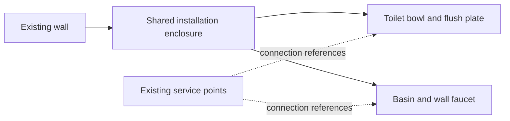

# Studio interior fixtures: feature proposal

Status: roadmap with an initial fixture implementation. See [Studio fixtures](studio-fixtures.md) for delivered behavior and remaining scope. Based on the checkout reviewed 24 October 2026.

## 1. Product direction

Extend Studio from a room envelope around furniture into a room that contains realistic fixed interior items. Start with bathrooms, then expand to laundry, heating, kitchen services, lighting, and architectural details. Keep movable furniture in the existing Furniture workspace.

The central decision: **an item, its installation, and its surrounding construction are different things**. A toilet is not just a mesh with a “plaster wall” checkbox. Its bowl, cistern/support, enclosure, finished faces, connections, and use space can have different dimensions and relationships.

Recommended defaults:

- Generic, dimensionally editable fixtures first; manufacturer-specific products later.
- One catalog card per recognizable item family; variants and sizes inside its editor.
- Useful presets place complete assemblies in one action, with every component still editable.
- The same placement and installation rules drive the preview, 3D scene, plan, saving, and schedules.
- Model relationships now; add pipe routing, construction detailing, and product procurement later.

## 2. What already exists and what is missing

| Current capability | Evidence | Consequence for this feature |
| --- | --- | --- |
| Rooms, walls, openings, and shaped ceiling solids | `src/domain/studio/studio.ts` | Extend Studio instead of introducing another room model. |
| Water, electrical, duct, gas, radiator, and switch items positioned on walls | `src/domain/studio/wall-utilities.ts` | Keep service points; connect fixtures to them instead of creating duplicate water/socket systems. |
| Studio toolbar has Walls and Shapes; a selected wall has Add | `src/domain/wardrobe/contextual-actions.js` | Add Fixtures as a peer; also expose suitable fixtures through Add to wall. |
| Add to wall already groups Utilities, Openings, and Shapes | `src/presentation/editor/add-menu-presenter.js` | Extend the contextual catalog rather than adding a separate full-screen editor. |
| Kitchen worktop sinks include a tap; independent sink/hob/shelf units also exist | `src/domain/kitchen/kitchen-units.ts`, `src/presentation/viewport/kitchen-fixture-renderer.ts` | Reuse rendering concepts and provide catalog shortcuts; avoid introducing a second independent kitchen-sink system. |
| Cabinet geometry supports rotated box collisions and vertical separation | `src/domain/geometry/cabinet-geometry.js` | Reuse geometry primitives, with fixture-specific compound volumes and support exceptions. |
| Physical Studio obstacles currently include walls and grounded shapes | `src/domain/studio/studio-obstacles.ts` | Visible utilities such as radiators do not yet contribute their physical depth here; address this during fixture integration. |
| Whole-scene snapshots and strict project serialization | `src/application/projects/editor-model.ts`, `src/infrastructure/serialization/project-codec.ts` | History is reusable; persistence still needs explicit schema, mapper, and validation changes. |
| Kitchen drawings distinguish modeled dimensions from unconfirmed installation data | `src/domain/drawings/appliance-setout.ts` | Extend this distinction to sanitary fixtures and installation schedules. |

The older Studio handoff is useful background but has stale behavior descriptions. For example, `startingScene()` currently creates one wall with no furniture, and current Studio navigation differs from the original Add item flow. Implementation should follow current code.

## 3. Where users find and edit items

### Studio navigation

Keep the current Studio/Furniture switch. Studio's unselected toolbar becomes **Walls · Ceiling · Fixtures**, followed by its existing history controls. The latest develop branch renamed Shapes to Ceiling; Fixtures keeps that name. Fixtures opens the shared catalog UI, with these groups as the library grows:

| Catalog group | Contents |
| --- | --- |
| Bathroom | Toilets, basins, taps, showers, baths, bidets, mirrors, bathroom accessories |
| Kitchen & laundry | Existing kitchen fixture shortcuts, utility sinks, laundry appliances, water heaters |
| Heating & ventilation | Existing radiators and vents, towel radiators, AC indoor units, extract fans |
| Lighting & electrical | Existing sockets/switches, wall/ceiling lights, pendants and service points |
| Construction & details | Installation enclosures, service boxing, ledges; later niches, trim, and sills |

The first release only needs Bathroom and a way to add an installation enclosure. Show additional groups when they contain available items. Search should recognize “sink/washbasin/basin,” “tap/faucet,” “WC/toilet,” and “boxing/prewall/enclosure.” Show type and installation labels on cards, not dozens of size combinations.

From a selected wall, **Add → Fixtures** filters to items that can be placed against or mounted on that wall. Existing utility entries remain reachable. From a selected basin, **Add → Faucet / Waste / Mirror** offers compatible accessories. From a selected toilet, Installation exposes its cistern, support, flush plate, and enclosure.

Use the existing desktop side panel/popovers and mobile bottom sheet. On phones, start with a short choice list and one primary next action; expand installation details on demand. Keep the object and its preview visible while editing. Reuse existing rulers, snapping guides, and refusal messages.

### Selected fixture controls

Use **Type · Size · Installation · Finish · More**. More contains Duplicate, Remove, and assembly selection. The Installation editor includes Position so mounting height is not confused with object size.

- **Type:** wall-hung/floor-standing, basin mounting, tap configuration, bath form, and similar variants.
- **Size:** overall dimensions plus named dimensions such as bowl projection, basin rim height, spout reach, or enclosure depth. Only show dimensions meaningful to that family.
- **Installation:** host surface, mounting datum, cistern/support, enclosure, connections, and access requirements.
- **Finish:** ceramic, metal, glass, cabinet, enclosure front/sides/top as applicable.
- **More:** duplicate the selected item or assembly; removal names the components affected.

Use “Installation enclosure” as the construction term, with plain-language choices such as “Small box behind toilet” and “Full-height wall lining.” Do not ask ordinary users to understand frame product codes.

## 4. Whole-house item library

Release labels: **R1** = first bathroom release; **R2** = broader wet-room coverage; **R3** = wider house interior. “Existing” means reuse or extend the current feature.

| Family | Important variants and details | Target |
| --- | --- | --- |
| Toilet | Floor-standing with exposed cistern; back-to-wall with concealed cistern; wall-hung; seat and bowl shape; projection; cistern/support and enclosure choice | R1 |
| Basin / washbasin | Wall-hung, pedestal/semi-pedestal, countertop vessel, inset, undermount; single/double; tap holes; overflow; waste position | R1 standalone and vessel; R2 remaining mounts |
| Faucet / tap | Basin or kitchen; deck-mounted, wall-mounted exposed/concealed; single lever, separate handles; tall/short spout; reach and finish | R1 basin deck/wall; R2 other variants |
| Bathroom vanity | Floor-standing or floating; one/two basins; drawer/door fronts; worktop; waste and service space | R1 fixed reference assembly; R2 editable cabinetry |
| Shower area | Tray or flush floor area; rectangular, corner, walk-in; drain position; threshold; footprint and height | R1 simple tray/area; R2 detailed floor construction |
| Shower screen / enclosure | Fixed panel, hinged door, sliding door, corner return; handed opening; glass and frame | R1 fixed and hinged; R2 sliding and complex sets |
| Shower fittings | Exposed/concealed mixer, rail/handset, overhead head, riser, outlet; wall or ceiling head | R1 basic set; R2 full combinations |
| Bathtub | Freestanding, straight built-in, corner; handed drain; panelled, tiled surround, deck-mounted fittings | R2 |
| Bath filler | Deck-, wall-, or floor-mounted; spout/handset; compatibility with bath rim and service locations | R2 |
| Bidet / hygiene spray | Floor-standing/wall-hung bidet; handheld spray; support, supply, waste and tap | R2 |
| Shower toilet / smart toilet | A toilet option with extra power, water, and service requirements; not another mounting system | R2 |
| Mirror | Rectangular, round, framed, illuminated; width/height; wall position and optional power requirement | R1 |
| Mirror cabinet / medicine cabinet | Surface-mounted or recessed; door swing; depth; integrated lighting | R2; recessed geometry later |
| Bathroom accessories | Towel rail/ring, hook, toilet-roll holder, brush, soap dish/dispenser, shelf, grab rail, shower seat | R2 |
| Floor drain | Point or linear; length; location; linked shower area; service requirement | R2 |
| Installation enclosure / service boxing | Local or shared; partial/full height; width/depth; painted, tiled, or panelled faces; ledge/cap | R1 |
| Niche / recess | Shower shelf niche, mirror recess, concealed cabinet; depth and host compatibility | R3; requires actual wall recess support |
| Kitchen sink / hob / tap | Existing kitchen sink/hob units and fittings; later separate tap selection, bowl count, mounting type and support checks | Existing; integration R2 |
| Kitchen appliances | Existing ovens, microwave, fridge, dishwasher, hood; later freestanding cooker/fridge and canopy variants | Existing; expansion R3 |
| Laundry sink | Wall-hung, freestanding, inset in a utility cabinet; tap, waste and splashback | R2 |
| Washing machine / dryer | Freestanding/integrated, side-by-side/stacked; door swing; service access; stack support | R2 |
| Water heater / boiler / cylinder | Wall/floor mounted; overall size; access zone; model-specific connections and vent requirements | R3 |
| Radiator | Existing panel radiator; column variants; valves; depth; heat-source appearance | Existing; depth integration R1, variants R3 |
| Towel radiator | Hydronic, electric, dual fuel; valve/power location; usable access space | R2 |
| Ventilation / AC | Existing vent point; extract fan/grille, indoor AC unit; wall/ceiling mounting and service space | Existing; expansion R3 |
| Electrical fittings | Existing sockets/switches; outlet gangs, data/TV, thermostat, intercom | Existing; expansion R3 |
| Lighting | Downlight, ceiling surface light, pendant, wall sconce, track, LED strip; host, drop/length and finish | R3; visual lighting fixtures before full lighting design |
| Architectural details | Skirting, cornice, window sill, curtain rail/rod, blinds, threshold, fireplace/hearth | R3; some need run/trim behavior rather than ordinary object placement |
| Movable room furniture | Bed, sofa, armchair, dining/coffee/side table, chair, desk, console, bedside unit, dresser, bookcase, rug | R3 through Furniture; reusable reference objects, separate from fixed installations |

R1 vanities are explicitly reference fixtures: editable outside size and appearance, excluded from furniture manufacturing and storage calculations. Custom carcasses, drawers, fittings, cutting lists, and costing should later use a proper bathroom furniture module. A reference vanity must not silently become a kitchen cabinet with irrelevant defaults.

Wall/floor tiles, paint, timber, stone, splashbacks, and ceiling finishes are also essential to interior design, but belong to a surface-finish workflow. Add them through selection of a wall, floor, ceiling, enclosure face, or a bounded finish region. Tile size, layout, grout, orientation, and build-up thickness belong to that workflow; a tile finish must not become hundreds of independently placed fixtures. An enclosure can have painted sides and a tiled front, with a separate top cap. New finish thickness must use a documented finished-face datum so it is never counted twice.

## 5. Toilets and the “with or without plaster wall” distinction

Treat the installation as three independent decisions: **how the bowl is supported, where the cistern is, and what construction surrounds it**. Presets choose sensible combinations; the compatibility rules prevent invalid combinations.

| User-visible preset | Bowl / support | Cistern location | What appears in the room |
| --- | --- | --- | --- |
| Toilet with visible cistern | Floor-standing | Exposed, coupled or separate | Bowl plus cistern; no new enclosure |
| Back-to-wall toilet, existing concealed cistern | Floor-standing | Within an existing suitable wall or enclosure | Bowl and flush control; no duplicate boxing |
| Wall-hung toilet, existing installation | Wall-hung with required carrier/support | Existing suitable wall cavity or enclosure | Suspended bowl and flush plate; installation assumptions remain recorded |
| Wall-hung toilet with small enclosure | Wall-hung with carrier | New local enclosure | Bowl, partial-height box, top ledge, flush plate |
| Concealed toilet with full-height lining | Floor-standing or wall-hung with compatible support | New lining | Bowl and flush plate on a full-height finished surface |
| Toilet with finished cistern module | Compatible floor-standing or wall-hung arrangement | Factory-finished module | Bowl and visible module; no plasterboard boxing |

New enclosures may span only the toilet, continue across a basin, or cover a whole wall. The cistern arrangement and enclosure length are separate choices. “No new enclosure” never means “no cistern or support needed.” A wall-hung bowl still records its supporting installation.

This separation reflects real products: Geberit documents in-wall, partition-wall, part-height and room-height prewall arrangements for Duofix, while Monolith is a finished cistern module. These are references for our modeling approach, not a claim that every bowl/frame/module combination is compatible. [Duofix installation arrangements](https://www.geberit-global.com/sanitary-piping-systems/installation-flushing-systems/geberit-duofix/), [Monolith sanitary module](https://www.geberit.com.sg/bathroom-products/wcs-urinals/sanitary-module-geberit-monolith/).

Store and edit:

- Bowl width, projection, rim/seat datum, floor clearance, bowl shape, seat, ceramic finish.
- Floor-standing or wall-hung support, cistern arrangement, frame/cistern dimensions where known.
- Flush plate face, horizontal/vertical placement, front/top access where supported by the selected installation.
- Enclosure width, finished depth, height, local/full-wall span, front/side/top finishes and cap/ledge.
- Existing/new construction status, existing enclosure reference, and known/unknown support/cavity suitability.
- Waste outlet direction/location, cold-water requirement, and extra electrical requirements for applicable variants.
- Use space, access to service controls, and product data status.

**Dimension example, illustrative only:** a new enclosure projects 20 cm from the original finished wall, and a bowl projects 54 cm from the enclosure face. The total projection into the room is 74 cm. A 54 cm bowl dimension alone would understate the space occupied. If the cistern is already within the existing wall and its finished face is unchanged, do not add that 20 cm again.

Changing enclosure depth moves its mounted bowl and flush plate with its face. Widening an enclosure must not stretch the bowl. Changing from wall-hung to floor-standing replaces the bowl/support configuration while retaining a compatible enclosure and finish. A shared enclosure must not disappear when one of its fixtures is deleted.

The solid arrows represent mounting relationships. Assembly membership is separate: the same enclosure can host members of several assemblies.

## 6. Basins, faucets, showers, and assemblies

### Basin and faucet rules

Separate basin, supporting cabinet/worktop, faucet, waste/trap, and mirror. A “Vanity with basin and tap” preset creates a linked assembly, not an indivisible mesh.

The basin mounting type changes the geometry: a vessel stands above its support; an inset basin has a rim and bowl below; an undermount basin hangs below a worktop; a wall-hung basin needs no cabinet. Mounting datums must distinguish underside, worktop top, basin rim, and faucet spout height. For example, an illustrative 80 cm support plus a 14 cm vessel gives a 94 cm rim height; “basin height 80” is ambiguous.

Deck-mounted faucets attach to the basin or worktop at a permitted mounting socket. Wall-mounted faucets attach to a wall or enclosure face and align to the basin; they do not become children of the basin's mesh. Check hole compatibility, spout reach, outlet height relative to the rim, and known product requirements. Give double basins explicit faucet/waste counts and positions.

Concealed wall faucets reserve a hidden installation volume separately from their visible trim. Exposed wall-mounted faucets are a different installation choice. Hansgrohe supplies both exposed wall-mounted basin mixers and concealed basic sets with specified mounting depth, supporting this distinction. [Exposed basin mixer](https://www.hansgrohe.com/articledetail-focus-single-lever-basin-mixer-for-exposed-installation-wall-mounted-31923000), [Concealed basic set](https://www.hansgrohe.com/articledetail-basic-set-for-single-lever-basin-mixer-for-concealed-installation-wall-mounted-13622180).

For existing kitchen sinks, preserve their current combined sink/tap representation until a deliberate compatibility adapter introduces separate taps. When a tap becomes an independent instance, suppress the sink's built-in rendered tap and represent it once in drawings and schedules. Existing projects must not gain a second faucet on reopening.

### Shower and bath rules

A shower assembly contains an area/tray, drain, screen/door, and fittings. These have different hosts: floor, wall, ceiling, or another fixture. Screen dimensions, handing, and opening space are independent of the tray. Moving a complete assembly carries its members and validates their new hosts together; moving only a tray rechecks its alignment with the screen and fittings.

A flush-floor shower is a defined area, not a solid block that prevents walking or falsely collides with everything inside it. A niche is an actual recess feature, not a decorative dark rectangle. Defer wall subtraction and detailed sloped floor layers until those geometries are supported.

A built-in bath may include a separate surround and panel finishes. A freestanding bath does not automatically receive a tiled enclosure. Floor-mounted bath fillers need independent placement while remaining associated with the bath.

### Presets and editing scope

Offer complete presets such as “Wall-hung toilet + enclosure,” “Basin + tap,” “Vanity + vessel + tap + mirror,” and “Shower tray + screen + fittings.” The ordinary tap selects the visible item; an explicit “Select assembly” action moves or duplicates the complete set. Highlight the affected parts before a command runs. A preset insertion, assembly move, variant change, and assembly duplication each form one undo step.

## 7. Placement, attachments, and construction behavior

| Concern | Proposed behavior |
| --- | --- |
| First placement | Choose preset, show a correctly sized preview, place on a compatible surface; Escape/cancel leaves no saved object. Offer exact entry after placement. |
| Free-standing items | Floor x/z and angle, with elevation where appropriate. Allow an open Studio with no walls; no need to force a closed room. |
| Wall mounting | Persist wall ID, side, along-wall offset, named mounting datum/height, and face offset. Reuse Studio's existing along-wall coordinate convention. |
| Enclosure mounting | Attach to enclosure ID plus face and local placement; derive world pose from its finished face. |
| Countertop mounting | Attach to a stable fixture/cabinet/worktop support identity and local socket; do not persist an ephemeral kitchen run ID, because runs are derived. Re-resolve support after run changes. |
| No compatible host | Show “Choose a wall,” “Choose a worktop,” or “Add a support.” Do not silently mount an item to an unsuitable surface. |
| Wall movement/rotation | Explicitly attached fixtures follow the wall transform. Nearby free-standing objects do not become attached merely because they touch a wall. |
| Wall shortened/split/merged | Preserve references where possible; split/merge remaps attachments to the correct segment while preserving their world placement. Refuse the operation with a named reason if the result cannot fit. |
| Host removal | Remove a whole assembly only through an action naming its members. Block deletion of a shared host until dependent items are reattached or explicitly included in removal. No silent orphaning. |
| Room replacement / No room | Preview affected attachments. Preserve free-standing items; resolve mounted dependencies before replacing or removing their hosts. “No room” must no longer blindly delete all Studio contents. |
| Enclosure resizing | Its finished outside dimensions govern collisions and room depth. Mounted children follow its face; their independent sizes remain unchanged. |
| Existing construction | Record existing/new status and reference existing geometry. Reusing an enclosure must not create a second solid at the same position. |
| Duplicate | Assign fresh instance/group IDs and remap internal references. Reuse external hosts only when valid; service connections become unconfirmed rather than silently reusing the original plumbing connection. |
| Snapping | Reuse `resolveAlignment`: wall/enclosure faces, basin/toilet centre lines, neighbours, mounting heights and support surfaces. Offer only reachable compatible targets. |
| Dimensions | Measure to the actual finished host face and fixture datum. Show overall projection plus selected installation dimensions where useful. |

Keep the enclosure as a dedicated construction object, not a fake ceiling pillar. Existing boxing geometry and profile tools may be reusable, but a service enclosure needs side/front/top materials, shared fixture attachments, installation space, and service access that ceiling objects do not express.

## 8. Physical fit, use space, and services

Use distinct rule outputs rather than treating all empty space as a collision box:

1. **Physical solids:** occupied ceramic, cabinets, glass, enclosures, radiators, etc. Impossible overlaps block placement. Use several simple volumes for curved/hollow shapes when one large box would reject a valid layout.
2. **Intentional support/installation relationships:** a basin can occupy its declared worktop opening; a concealed component can occupy its declared installation cavity. Exempt only that named relationship and bounded region. Being in the same assembly must not disable all collisions between its members.
3. **Use/opening space:** toilet approach, basin use area, shower/bath access, door swings, drawers, laundry doors. Show advisory findings and measured gaps. Some use zones may overlap each other; they should not all become exclusive solids.
4. **Service space:** cistern access, valves, trap access, appliance servicing. Preserve access separately from the visible fixture shape.
5. **Connections:** required hot/cold water, waste, power, and ventilation, linked to existing wall utilities when specified. “Connected” means an association in this phase, not a routed or verified installation.

Known incompatible mounts or insufficient installation depth are errors. Unknown wall construction, missing service confirmation, or generic product installation details are review findings rather than invented certainty. Store the source of a requirement: generic design guidance, manufacturer data, project override, or a future regional ruleset. Do not call a generic planning gap a universal legal minimum.

Current water utilities combine hot/cold/waste in one wall item. R1 can link a fixture requirement to that item with an explicit service role and confirmation status. Do not claim exact pipe locations from the combined symbol. Later, add separate service ports without discarding older utility objects.

Collision queries must work both ways: moving a fixture into a wardrobe and moving a wardrobe into a fixture use the same physical scene. A wall/enclosure edit validates its attached fixtures, their clearance against all other objects, and remaining cabinet fit together. Include high objects and under-ceiling fit; allow a mirror above a basin without a floor-footprint false collision.

## 9. Proposed domain and persistence design

Add a focused fixture module within the existing application; no new service or database catalog is required for generic items.

| Data | Responsibility |
| --- | --- |
| Fixture definition registry | Stable kind, family, supported variants, parameter schema, default dimensions, anchors/sockets, compatibility, solid volumes, clearances, service roles, drawing-symbol and renderer keys |
| Fixture instance | Stable ID, definition/version reference, explicit resolved size/options, attachment, material choices, existing/new status, optional assembly membership and product reference |
| Installation configuration | Bowl support, cistern type/location, hidden equipment envelope, finish datum, access face, requirements and confirmation state; type-specific validated data |
| Enclosure instance | Stable ID, wall/floor host, finished width/depth/height, span, per-face finishes, existing/new status; fixtures refer to it rather than each owning a copy |
| Assembly | Stable ID and member relationships for grouped editing; shared hosts remain outside exclusive assembly ownership |
| Connection | Fixture service port/role, utility ID, and confirmation state |

Proposed optional fields on `Studio`: `fixtures`, `enclosures`, `fixtureAssemblies`, and `fixtureConnections`. Keep these absent for existing documents that contain no such data. Use one canonical attachment record per item: floor pose OR wall anchor OR enclosure-face anchor OR supported-fixture/cabinet anchor. Derive world transforms for attached items; do not save a second independently editable position.

Anchors identify the mounting datum in the definition, so a rim height is not confused with the object's bounding-box origin. Continue using centimetres internally; convert through existing drawing utilities for millimetre output. Store catalog defaults resolved on insertion and a definition revision so later catalog edits do not silently resize saved rooms. Product-specific sizes can be fixed; generic instances expose controlled editable parameters rather than uniformly scaling a toilet or faucet mesh.

Validate IDs, graph cycles, host existence, anchor compatibility, finite positive sizes, allowed options, dimensions, and shared references. Separate structurally invalid data from valid designs with unresolved installation review findings. Keep selection, previews, evaluated collision volumes, Three.js objects, camera state, and derived world transforms transient.

The project codec currently uses strict objects and schema version 1. Optional fields let the new reader accept old projects, but old readers will reject documents containing the new fields. Recommended release strategy: introduce a versioned reader for the new document shape, migrate v1 in memory without adding fixtures, and write the new version when fixture data is used. Do not promise old-app compatibility or silently drop unknown fixtures. Audit draft recovery (which currently normalizes some retired formats), imports, downloads, save/load, and dirty comparisons before enabling writes. Draft recovery already recognizes a retired version-2 ceiling format: choose the next version deliberately and distinguish that legacy format instead of blindly reusing its version number. A version bump must be a deliberate codec change, not an incidental field addition.

Adding a floor fixture to a project with no Studio may create an empty custom Studio container without walls; the current structural validator permits an empty room. Mounted fixtures still require an appropriate host. Preserve this open-floor behavior in save/load and room-removal commands.

### Implementation ownership

| Area | Suggested modules / integration points |
| --- | --- |
| Definitions and geometry | New `src/domain/studio/fixtures/` modules for definitions, instances, anchors, installation, enclosures, volumes, compatibility, and issues |
| Studio model / validation | `studio.ts`, `studio-validation.ts`, `studio-clean.ts`; shared scene-solid adapter alongside `studio-obstacles.ts` |
| Commands | New `src/application/commands/fixture-commands.ts`; integrate transactional host edits with `studio-commands.ts` and scene commands |
| History / save mapping | `editor-model.ts`, `editor-mapper.ts`, `sceneDesignKey`, project types and strict codec; identity and draft recovery handling |
| Catalog / editor | `studio-panel.ts`, `add-menu-presenter.js`, contextual action registry; new fixture picker, installation/size panels and typed ports |
| Selection / gestures | `selection-state.js`, `scene-selection.js`, room wiring; add a discriminated fixture/enclosure selection without repurposing cabinet indexes |
| Rendering | New fixture/enclosure renderers with family render modules; share useful basin/tap/metal/glass helpers from existing furniture rendering |
| Camera / frame bounds | Include visible fixtures/enclosures in room framing, selection framing and occlusion; keep cabinet planner bounds scoped to cabinets |
| Drawings | Extend room plan/elevations with fixture symbols and finished-face dimensions; add fixture/installation schedules beside existing appliance schedules |
| Composition / lifecycle | Wire through existing runtime ports; register listeners and dispose meshes/materials through editor ownership |

Registry entries supply allowed variants, placement behavior, and available actions. Avoid copying lists of item kinds into menus, collision code, renderers, and codecs. Renderer implementations stay in presentation and resolve registry keys through a checked adapter.

Use parametric family geometry for generic items: a toilet needs a recognizable bowl opening, seat and cistern; a basin needs an actual bowl; a faucet needs independent stem, spout and controls. Keep visible geometry, picking geometry, and physical/clearance volumes separate. Reuse materials and geometry where possible, invalidate only changed objects, and check glass/shadow cost on phones. Manufacturer assets can later replace visible geometry while retaining the same anchors, dimensions, and rule contracts.

New fixed fixtures must not enter wardrobe Auto design, wardrobe storage counts, cabinet manufacturing checks, cutting lists, or furniture cost calculations. Drawing export includes them as room context and a separate schedule; generic dimensions remain identified as modeled rather than verified product installation dimensions. A detailed enclosure material takeoff is a later construction feature, not part of wardrobe manufacturing.

## 10. Delivery sequence and release gates

| Step | Deliverable | Exit condition |
| --- | --- | --- |
| 0. Interaction prototype | Fixtures catalog, placement preview, selection/Installation panel; sample toilet variations and basin/tap | Desktop and 375 px phone flow can place and edit a realistic assembly without requiring construction terminology |
| 1. Complete toilet slice | Fixture registry, attachments, enclosure object, toilet presets, materials, compound solids, undo/save/reopen | Exposed toilet, existing concealed installation, and new boxed wall-hung toilet work end to end; room changes cannot corrupt hosts |
| 2. Basin and faucet slice | Standalone basin, vessel + reference vanity, deck/wall tap, mirror; grouping and support checks | Heights and dependencies remain correct when moving/resizing/duplicating the assembly |
| 3. First bathroom release | Basic shower area/tray, fixed/hinged screen, shower fittings; service associations, clearance findings, plan/elevation/schedule support | A complete simple bathroom can be planned, saved, reopened, and documented; existing wardrobe/kitchen behavior remains unchanged |
| 4. Wet-room expansion | Baths, bidets, accessory set, detailed basin mounts, laundry, towel radiators, editable bathroom furniture | Shared-wall and mixed bathroom/laundry layouts work with appropriate family-specific rules |
| 5. Whole-house coverage | Lighting, ventilation/heating variants, architectural detail systems, movable reference furniture | Extend the registry by family; avoid forcing trim runs, recesses, or custom furniture into inappropriate fixture geometry |

Do not estimate the whole-house library as one implementation task. Each slice includes data, commands, visible behavior, persistence, drawings where applicable, and verification. Begin with the complete toilet slice because it proves the most important installation/enclosure relationships before multiplying item families.

### Acceptance scenarios

- A floor-standing exposed-cistern toilet adds no enclosure. A wall-hung preset with a new enclosure creates its bowl, installation and box as one history action.
- Switching to an existing concealed installation removes only an exclusively owned generated enclosure after dependencies are resolved; it does not delete a shared construction object.
- A toilet and basin share a tiled enclosure. Changing its depth updates both mounting faces; deleting the toilet leaves the basin and enclosure intact.
- A bowl with 54 cm projection behind a 20 cm enclosure shows 74 cm total projection from the original finished wall, using illustrative generic sizes.
- A wall-mounted faucet stays on its host when the basin moves and reports a new alignment issue; selecting and moving the full assembly can move both when all hosts remain valid.
- A vessel, support and faucet preserve independent dimensions; changing the support height updates rim/spout relationships without scaling the ceramic or metal parts.
- Fixture-to-cabinet and cabinet-to-fixture collision checks agree. Mirrors above basins and declared concealed/support overlaps remain possible.
- Moving, rotating, shortening, splitting, merging or deleting a host wall preserves valid attachments or rejects the complete change with a specific explanation.
- Unsupported countertop fixtures, undersized enclosures, obstructed access, and unknown connections produce the intended error or review finding, with useful on-canvas feedback.
- Duplicate assigns fresh identities and remaps internal anchors; undo/redo restores the whole assembly and its shared-host relationships.
- Save/reopen, export/import, draft recovery and dirty detection retain sizes, finishes, installations, connections and IDs, including a Studio containing fixtures but no cabinets or walls.
- Old projects retain their prior geometry and planner results. Newer fixture documents are not silently loaded and resaved by an older reader.
- Plan/elevation dimensions reference the correct finished surface; fixture schedules list installation assumptions separately from verified product information.
- Desktop and 375 px touch flows support cancel, exact sizes, keyboard focus, readable controls, and single-step history. Multi-editor mounts and disposal remain independent.
- Registry coverage verifies each shipped definition has placement rules, a renderer, catalog art, serialization validation, and a drawing symbol where the release includes drawings.

Use focused domain/command/codec tests for these relationships, then the existing repository checks and browser verification for implementation releases. This proposal changes documentation only; it does not claim that any of these new behaviors have been implemented or tested.

## 11. Scope decisions to carry into implementation

Recommended decisions are concrete enough to start design without further product choices: Bathroom first; Fixtures in Studio; generic editable products; presets that expand into linked components; separate shared enclosures; a reference vanity before custom cabinetry; advisory planning clearances with explicit provenance; existing utilities as service endpoints; and a deliberate versioned persistence rollout.

Defer exact branded catalogs, pricing/procurement, pipe/cable routes, drainage calculations, automatic regional compliance checks, structural approval, detailed waterproofing layers, complex wall/floor subtraction, and photorealistic asset breadth. These need their own data and workflows. The first release should make a small bathroom accurate to arrange and honest about what its dimensions represent.
